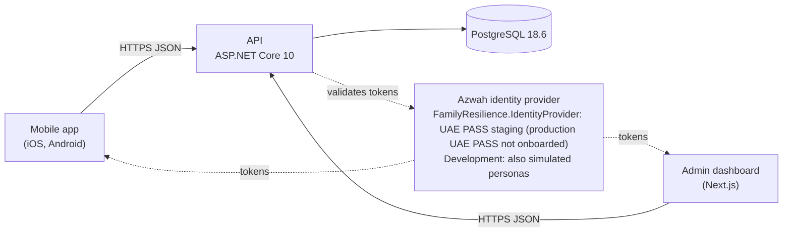
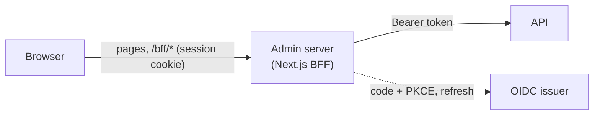

# Architecture

## 1. Context

Four runtime pieces:

| Piece | Who uses it | Technology |
| --- | --- | --- |
| Mobile app | Family members on iPhone and Android | Expo SDK 57, React Native 0.86, Expo Router |
| Admin dashboard | Researchers, support coordinators, administrators | Next.js 16.4, React 19.3 |
| API | Both clients | ASP.NET Core 10, modular monolith |
| Database | The API only | PostgreSQL 18.6 |

Clients never hold business rules: eligibility, scoring and authorisation decisions happen in the API. The API calls
no AI service: the support-resource language-model path has no provider (D-94).

## 2. Backend layers

| Project | References | Holds |
| --- | --- | --- |
| `FamilyResilience.Domain` | nothing | Entities, value objects, `Result`/`Error`, domain rules |
| `FamilyResilience.Application` | Domain | Use cases, abstractions (`IUnitOfWork`, repositories, `ICurrentUser`, `IAuditLog`), validators |
| `FamilyResilience.Infrastructure` | Application, Domain | EF Core context, configurations, migrations, repositories, health checks |
| `FamilyResilience.Api` | Application, Infrastructure | Controllers, authentication and authorization, error handling, CORS, OpenAPI, telemetry, composition root |
| `FamilyResilience.UnitTests` | all four | Architecture, domain, application and model tests |
| `FamilyResilience.IntegrationTests` | Api | HTTP tests against real PostgreSQL (Testcontainers) |
| `FamilyResilience.IdentityProvider` | nothing (its own app) | OpenID Connect provider brokering UAE PASS; simulated personas in Development only (D-129) |

`DependencyRulesTests` checks both the declared project references and the compiled assembly references, so a
forbidden dependency fails the test run. The Application layer has no reference to EF Core, ASP.NET Core or Npgsql.

## 3. Modules

Modules are folders and namespaces inside each layer. Each module's `backend/FamilyResilience.Application/<Module>/README.md`
states what it owns, what others may use and what it must not do.

| Module | Owns | Status |
| --- | --- | --- |
| Identity | Mapping OIDC subjects to platform users; roles; the current-user abstraction; caller access | `platform_users`, `CallerAccess`, `GET /api/v1/me`, `GET /api/v1/me/permissions`, `POST /api/v1/me/registration` (D-47, D-48, D-97) |
| Households | The household aggregate and which users belong to it | Participant endpoints: create, read, withdraw, roster, confirm roster (D-50) |
| Members | Family members: age, relationship, employment, main-earner flag | Members endpoints with merge-patch updates (inside the household aggregate) |
| Consent | Consent document versions; grants and withdrawals per member and purpose | Current policies, grant and withdraw, the caller's consents (D-51); no approved policy text |
| Questionnaires | Instruments, versions, items, options, scoring rule sets, eligibility rules | Staff endpoints (including version and rule-set lists for the dashboard, D-74), plus published content for participants; the codebook is a draft; nothing approved |
| Assignments | Which member answers which instrument version in which wave | Staff endpoints, roster confirmation through `HouseholdAssignmentService`, the caller's assignments, the wave list for staff filters (D-74) |
| Sessions | Assessment sessions and responses | Participant endpoints: start, save answers, submit (scored and routed in one transaction, D-52), result, history |
| Scoring | Deterministic scoring with approved rule sets | `SessionScoringService` used at submission and by staff; no scoring rule set approved |
| Referrals | Support referrals, recommendations and routing rules | `referral.v1`, `ReferralRouter`, recommendations and referrals lists (D-53); partner organisations and manual hand-offs (D-61) |
| Analytics | De-identified read models and program monitoring | Analytics overview with suppression (D-55) and started counts, researcher-only score distributions (D-59, D-62), participation and assessment monitoring with version and date filters; research exports with the requester's list and the catalog (D-60, D-74) |
| Privacy | `PrivacyRequest`, the family data download | A copy of a family's data and access, correction and erasure requests that program administrators close (D-89); erasure itself is the Households module's `EraseHousehold` (D-88) |
| SupportResources | The approved support-resource directory, its deterministic search, and the language-model port, prompt and guard | Admin directory endpoints, `POST /api/v1/support-resources/search` and `GET /api/v1/support-resources/{resourceId}` (D-92, D-93); the directory is empty (nothing approved or seeded); the language-model path is dormant with no provider adapter (D-94); isolated from every participant-data module ([`support-resource-discovery.md`](support-resource-discovery.md)) |
| Safeguarding | `SafetyAlert`: fixed-code records that a detector flagged a possible crisis or a scored household fell in the lowest approved band; `CrisisSignalScreen` and `ISafetySignalRecorder` | Admin endpoints under `/api/v1/admin/safety-alerts` (system administrators only); recorders in the assistant chat, the consultant, support search and the score outbox (D-135 to D-138); the phrase list is not clinically reviewed (open question 58) |
| Audit | `AuditEvent`, `IAuditLog` | Built; events can be staged into a use case's transaction |

## 4. Request flow

Middleware runs in this order (`backend/FamilyResilience.Api/Program.cs`):

1. **Exception handler**: any unhandled exception becomes a generic 500 ProblemDetails with a trace ID; the exception is
   logged on the server only.
2. **Status code pages**: empty 4xx/5xx responses (for example 401 and 404) get a ProblemDetails body.
3. **CORS**: only origins in `Cors:AllowedOrigins` get a CORS grant. None by default.
4. **Authentication**: JWT bearer tokens validated against `Authentication:Schemes:Bearer`.
5. **Authorization**: every endpoint requires a signed-in caller unless it is `AllowAnonymous`; named policies on top,
   with resource requirements decided from the caller's household membership. A failed resource requirement answers 404
   (`AuthorizationResultHandler`).
6. **Endpoints**: health checks and controllers. A `ValidationFilter` runs FluentValidation before each action.

At startup the API refuses to run without `ConnectionStrings:Default`, or with the support-resource language model
switched on without an approval reference, a registered provider and in-range settings (`LanguageModelStartupGuard`,
D-94). It applies migrations only when `Database:ApplyMigrationsOnStartup` is true (development and tests).

## 4a. Persistence

`FamilyResilienceDbContext` maps every persisted aggregate; conventions map IDs, enums (checked text) and `xmin`
concurrency; each save also writes domain events to `outbox_messages`. Use cases commit through `IUnitOfWork`. Rules:
[`database-conventions.md`](database-conventions.md).

List views and aggregates are read models in `Infrastructure/Persistence/ReadModels`, behind Application interfaces
(`IAccessQueries`, `IAssignmentReadModel`, `ISessionReadModel`, `IMonitoringReadModel`, `IAnalyticsQueries`,
`ISupportResourceSearch`). They read untracked, filter and page in PostgreSQL, and never accept SQL, columns or
expressions from a request.

## 4b. Background processing

Two hosted services run inside the API (D-56): `OutboxDispatcherService` delivers due outbox messages of handled types
to in-process handlers through `OutboxProcessor`, with bounded, backed-off retries; `MaintenanceService` purges expired
idempotency keys hourly. `BackgroundJobs:Enabled` turns both off. There is no message broker, and nothing is sent
outside the platform.

## 5. Clients

**Mobile** (`apps/mobile`): routes in `app/` (Expo Router), code in `src/`:

| Folder | Holds |
| --- | --- |
| `src/design-system` | Brand (`brand.ts`), tokens, fonts and components (`AppText`, `AppButton`, `AppInput`, `AppCard`, `AppHeader`, `Screen`, `FormField`, `RadioCardGroup`, `LikertScale` and others; `apps/mobile/README.md`) |
| `src/i18n` | Languages, Arabic and English resources, the right-to-left decision and reload |
| `src/api` | Fetch client with timeouts and Zod validation, health status, TanStack Query hooks |
| `src/storage` | Expo SQLite with versioned migrations; settings repository |
| `src/app-shell` | Start-up: storage, language, direction, translations |
| `src/features` | Feature UI (today: the API status card) |

**Admin** (`apps/admin`, D-73 to D-75): a backend-for-frontend. The browser talks only to the Next.js server, which
holds the session and calls the API.

| Folder | Holds |
| --- | --- |
| `src/proxy.ts` | Sends requests without a session to sign-in; refreshes OIDC tokens before they expire |
| `src/app/(dashboard)` | Pages behind the session: overview, monitoring, analytics, exports, configuration, status; the layout loads `GET /api/v1/me/permissions` on the server |
| `src/app/auth`, `src/app/sign-in` | OIDC sign-in with PKCE, callback, sign-out; development sign-in |
| `src/app/bff/[...path]` | The allowlisted API proxy: adds the bearer token, keeps status and body, never caches |
| `src/lib/server` | Server-only configuration (fails closed), JWE session cookie, OIDC, BFF, caller and page guards |
| `src/lib/api` | Zod schemas for every response, the BFF client, TanStack Query hooks |
| `src/lib/mock` | Development-only mock of the API's admin routes over synthetic data |
| `src/features`, `src/components` | One folder per page; the shell, states, badges, pagination and chart figure |

Both clients read the same health contract (`/health/live`, `/health/ready`; 503 means "not ready") and map it to the
same states: ready, not ready, unreachable, not configured. The admin reads it on its server (`/bff/health`). The logic
is duplicated in each app on purpose: the apps share no packages because Expo and Next.js pin different React
versions.

## 6. Local development topology

| Service | Default address | Notes |
| --- | --- | --- |
| PostgreSQL | `127.0.0.1:5432` | Compose; loopback only |
| API in Compose | `http://localhost:8080` | Published on all interfaces so phones on the same Wi-Fi can reach it |
| API with `dotnet run` | `http://localhost:5080` | Launch profile, Development environment |
| Identity provider | `http://localhost:5090` | Compose (loopback only) or `npm run identity:dev`; the issuer address every client uses |
| Admin in Compose | `http://localhost:3000` | Production build against the Compose API, staff sign in through the identity provider (D-150) |
| Admin with `npm run dev` | `http://localhost:3000` | Mock data by default from `.env.example`, or `ADMIN_API_URL` for the API |
| Android emulator | `http://10.0.2.2:<port>` | Reaches the host machine |

Ports can be overridden in the root `.env` (`POSTGRES_PORT`, `API_PORT`, `IDENTITY_PROVIDER_PORT` with
`IDENTITY_PROVIDER_ISSUER`, `ADMIN_PORT`).

## 7. Deviations from the original brief

| Deviation | Why |
| --- | --- |
| `FamilyResilience.slnx` | .NET 10's default solution format |
| Ignored `/materials` folder | Personal and hackathon files stay out of git |
| Mobile routes in `apps/mobile/app`, code in `apps/mobile/src` | Keeps screens separate from reusable code |
| .NET `TimeProvider` instead of a custom clock interface | Built into .NET and testable without extra code |
| Auth settings under `Authentication:Schemes:Bearer` | The framework's own section, also used by `dotnet user-jwts` |
| Admin created without Cache Components | Every admin page is per-user and dynamic |
| `backend/dotnet-tools.json` instead of `backend/.config/` | Where .NET 10 creates the tool manifest |
