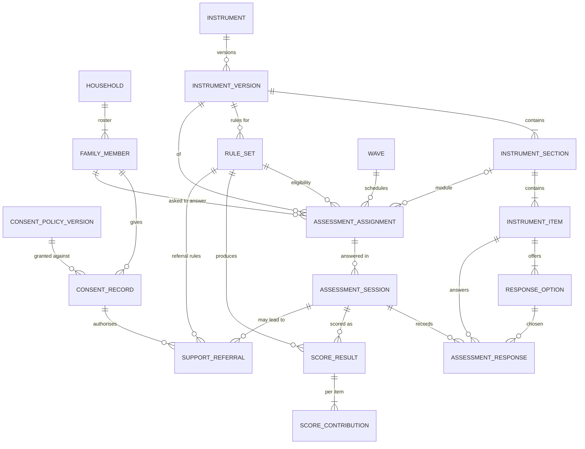

# Domain model

The domain model is built for every entity below (`backend/FamilyResilience.Domain`), and every aggregate is persisted
in PostgreSQL. Staff endpoints exist for questionnaires, rule sets, eligibility, assignment and scoring; participant
endpoints exist for households, consent, assignments, sessions and support, decided from platform users and household
memberships (D-47 to D-53). Referrals are created only by approved `referral.v1` rule sets with referral consent, and
none is approved outside test databases (open questions 13 and 33). The support-resource directory has admin and
reader endpoints and stands apart from all participant data (D-92, D-93). Screens arrive with the phases in
[`development-plan.md`](development-plan.md).
How the model maps to tables: [`database-conventions.md`](database-conventions.md).
Design decisions: [`decisions.md`](decisions.md).

## Principles

- **Two instruments, never mixed.** The household assessment and the family-voices modules are separate
  `Instrument` rows. Their versions, items, options and rule sets never mix, and their results are never combined.
- **Approved content is immutable.** An instrument version, rule set or consent policy cannot change once approved; a
  change is a new version. Responses point at the exact version, item and option answered. The domain and database
  triggers both enforce this.
- **Only approved rules are used.** Assignments, score results and referrals reference an exact approved rule-set row,
  which records approver, approval time and source.
- **Data minimisation.** No names, identity numbers, contact details, region or free-text answers. Ages come from year
  and month of birth.
- **Sensitive by default.** Responses, scores, consent and member details are sensitive personal information.
- **History is never cascade-deleted.** Members and households are deactivated; erasure is an explicit procedure
  ([`database-conventions.md`](database-conventions.md#retention-and-deletion)).
- **The audit log and the outbox hold no free text.** Domain events carry IDs, enum values, numbers and times only.

## Aggregates

An aggregate is a consistency boundary: it is loaded and saved as a whole through one repository, raises domain
events, and carries one concurrency token (`xmin`).

| Aggregate root | Module | Also contains | Persisted | Main invariants |
| --- | --- | --- | --- | --- |
| `Household` | Households | `FamilyMember` (Members), `HouseholdMembership` | Yes | At most one active head and one active primary earner, both 18 or over; at most 30 active members; the head has no relationship value; members are deactivated, never deleted; created by enrolment with its manager membership (manager 18 or over, never deactivated); a member with an account stays 18 or over; a confirmed roster has one active head, a relationship for every other active member and an employment status for every active adult, and any roster change clears the confirmation; a user and a member each have at most one active membership; a manager may act for active members without an account (D-49) |
| `ConsentPolicyVersion` | Consent | | Yes | Draft → Approved → Retired; immutable once approved |
| `ConsentRecord` | Consent | | Yes | Granted only against an approved policy for an active member; one active record per member and type; withdrawal is a state change |
| `Instrument` | Questionnaires | | Yes | Code unique; kind is household assessment or family voices |
| `InstrumentVersion` | Questionnaires | `InstrumentSection`, `InstrumentItem`, `ResponseOption` | Yes | Content changes only while Draft; approval needs bilingual content, content references, a section, items and two options per single-choice item, and a consecutive scale for reverse items; options can be marked non-substantive; approved windows never overlap; retired from now or an earlier time, while a future end is set with `ScheduleEnd` and the version stays effective until then |
| `RuleSet` | Questionnaires | | Yes | Kind scoring, eligibility or referral; Proposed → Approved → Retired; approved only for an approved version; immutable once approved |
| `Wave` | Assignments | | Yes | Closes after it opens; Planned → Open → Closed |
| `AssessmentAssignment` | Assignments | | Yes | Only for an active adult, an approved and effective version, a section of that version, an open or planned wave and an approved eligibility rule set of that version; one live assignment per member, version, section and wave |
| `AssessmentSession` | Sessions | `AssessmentResponse` | Yes | Answers only while in progress, only for items of the version and (for a module) the section, one response per item; submission needs every required item; read-only after submission |
| `ScoreResult` | Scoring | `ScoreContribution`, `ScoreCategoryScore` | Yes | Records an approved scoring rule set of the session's version, with its policy code and algorithm version; status Complete or Incomplete; contributions match the recorded answers; never changed |
| `PlatformUser` | Identity | | Yes | One per token subject (1–200 characters); no name or identity-provider data |
| `SupportRecommendation` | Referrals | | Yes | Records that an approved referral rule set routed a scored session's score result to a category; the session must be Scored, the score its own, the rule set an approved referral rule set of its version; links the referral it produced, if any; never changed |
| `SupportReferral` | Referrals | | Yes | Needs a scored session, an approved referral rule set of the session's version and an active referral consent of the same member; one live referral per session and category; keeps its session, member, version, category, rules and consent; Open → InProgress (a service is assigned, or a support coordinator records a manual hand-off to an active partner that covers the category, only while the consent is active; the hand-off never changes), and Open or InProgress → Resolved or Cancelled; a resolved or cancelled referral never changes |
| `PrivacyRequest` | Privacy | | Yes | A family's access, correction or erasure request for one member the requester may act for; no free text; one open request per member and type; Open → Closed with a resolution (completed, declined, withdrawn) by a program administrator; a closed request never changes; erased with the household (D-89) |
| `PartnerOrganisation` | Referrals | | Yes | Unique snake-case code; name in Arabic and English; 1 to 20 distinct support categories; active or inactive; registered by system administrators, never seeded; a record only, with no integration (D-61) |
| `SupportResource` | SupportResources | | Yes | One version of a directory entry: unique code and version number, the next free number for a new draft; Draft → Approved → Retired, at most one approved version per code; content changes only while Draft; approval needs Arabic for every text, an approver, a source and a review date after the approval and at most 366 days later; findable only while Approved and before the review date; an `https` link, 1 to 10 categories, up to 10 audiences, 1 to 5 service languages, `Everyone` or `StaffOnly` visibility; never seeded; raises no domain events; no participant data and no link to any other aggregate (D-92) |
| `SafetyAlert` | Safeguarding | | Yes | A record that a detector flagged a possible crisis, or that a scored household fell in the lowest approved band (D-135, D-136). Fixed codes only, never text; severity is derived from the concern; subject, source, concern, severity and first detection never change; at most one unresolved alert per user, concern and source, and one per scored session; Open → Acknowledged → Resolved (or Open → Resolved) with a resolution code; a repeat adds to the count and is refused once resolved |
| `AuditEvent` | Audit | | Yes | Append-only; no free text |

## Relationships

- **Household → members.** A household owns its roster. Children are ordinary members (relationship and year/month of
  birth only); "the household includes someone under 18" is derived from the roster on any date.
- **Member → consent.** A member grants consent per purpose (participation, research use, referral) against an
  approved policy version. The record copies the member's household; the database checks that the pair matches.
- **Instrument → version → sections → items → options.** One instrument has many versions; content belongs to exactly
  one version. Family-voices modules A, B and C are sections of the family-voices version.
- **Version → rule sets.** Scoring, eligibility and referral rule sets each belong to one version.
- **Wave, member, version (and section), eligibility rule set → assignment.** An assignment says a member answers a
  version, or one module of it, in a wave, because an approved eligibility rule set said so.
- **Assignment → sessions → responses.** A session copies its assignment's member, version and section; the database
  checks the member and version copies with a composite foreign key and the section copy with the
  `trg_assessment_sessions_guarded` trigger, which also keeps the copies from changing later. At most one session per
  assignment is not abandoned. Each response names an item of the session's version and one of that item's options,
  with the option's raw value.
- **Session → score results → contributions.** A score result records the scoring rule set used. Scoring with another
  approved rule set adds a result; results are never edited.
- **Session + referral rules + referral consent → referral.** A referral copies its session's member and version and
  records the rule set and the consent that authorised it; composite foreign keys check that the session, rule set and
  consent agree on member and version. The `trg_support_referrals_guarded` trigger checks, when the referral is
  inserted, that the session is scored, the rule set is an approved referral rule set and the consent is an active
  referral consent, and it locks that consent so a concurrent withdrawal waits.
- **Support resources stand alone.** A `SupportResource` references no household, member, session, score, consent or
  referral, and nothing references it. The only shared vocabulary is its snake-case category codes, as plain strings
  (D-92).

## Engines

Three pure-domain engines sit behind the use cases. None reads the database, and none is approved to run on real
content yet.

- **Eligibility** (`Domain/Assignments/Eligibility`): evaluates a strict `eligibility.v1` rule for a member and returns
  eligible, ineligible or indeterminate, with a reason code.
  Rules: [`assessment-rules.md`](assessment-rules.md).
- **Assignment planner** (`Domain/Assignments/AssignmentPlanner`): turns the eligibility decisions and the assignments
  already in the wave into create, cancel and keep lists.
- **Scoring** (`Domain/Scoring`): strategies chosen by policy code and algorithm version compute a result from a
  snapshot of the answers, the approved version and the approved rule set.
  Rules: [`scoring-specification.md`](scoring-specification.md).

## Value objects and enumerations

| Type | Meaning |
| --- | --- |
| `LocalizedText` | Arabic and English text, both required except in drafts (`CreateDraft`; see D-40); the Arabic must contain Arabic script |
| `YearMonth` | Year and month of birth; age counts the birthday as the 1st of the month |
| `HouseholdReference` | `HH-XXXX-XXXX`, random Crockford base 32; never derived from an ID |
| `Approval` | Approver subject, time and source document |
| `HouseholdRelationship`, `EmploymentStatus`, `ConsentCaptureMethod` | **Proposed** lists, not yet approved (open question 18) |
| `SupportResourceContent` | The editable content of a support resource, validated as a whole by `Create`; Arabic may be missing until approval |

Tier, referral category, service, resolution, support-resource category and audience values are snake-case codes, not
enums, because their values are not approved.

## Domain events

Written to `outbox_messages` in the same transaction as the change. Payloads carry IDs, enum values and times only.

| Type code | Raised by |
| --- | --- |
| `households.household_created.v1`, `households.household_withdrawn.v1`, `households.family_member_deactivated.v1`, `households.roster_confirmed.v1` | `Household` |
| `consent.consent_granted.v1`, `consent.consent_withdrawn.v1` | `ConsentRecord` |
| `questionnaires.instrument_version_approved.v1`, `questionnaires.instrument_version_retired.v1` | `InstrumentVersion` |
| `assignments.assessment_assigned.v1` | `AssessmentAssignment` |
| `sessions.assessment_session_submitted.v1` | `AssessmentSession` |
| `scoring.score_result_recorded.v1` | `ScoreResult` |
| `referrals.support_referral_created.v1`, `referrals.support_referral_status_changed.v1` | `SupportReferral` |

## `AuditEvent`

`backend/FamilyResilience.Domain/Audit/AuditEvent.cs`. Created only through `AuditEvent.Create`, which rejects:
non-UTC times; actions that are not dotted lowercase codes of at most 100 characters (for example
`system.health.checked`); a missing or over-long resource type; over-long resource, actor or correlation IDs; a user
actor without an ID; an anonymous actor with an ID; undefined enum values. Stored in `audit_events` with indexes on
`occurred_at` and `(resource_type, resource_id)`; a trigger refuses updates. Use cases stage events with
`IAuditLog.Stage` so they commit with the change; `IAuditLog.RecordAsync` records a standalone event.
