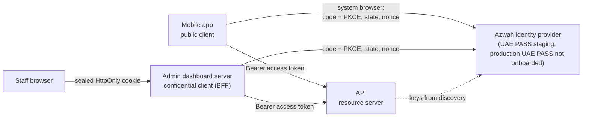

# Security model

What the platform does to protect families' data, and what a deployment must add. Threats, mitigations and residual
risks are in [threat-model.md](threat-model.md); retention in [retention-policy.md](retention-policy.md). None of this
has been independently assessed: the platform is not security-certified, and no claim of legal compliance is made.

## Data classification

| Class | What | Handling |
| --- | --- | --- |
| **Public** | App text, translations, brand assets, published questionnaire wording (once approved), approved support-resource directory entries (D-92) | No restrictions; integrity matters most for approved content |
| **Internal** | Audit events, health status, metrics and traces, questionnaire drafts, rule sets, partner list, wave calendar, export catalog, support-resource drafts and retired versions | Staff and operators only; no personal data beyond token subjects and opaque IDs; no free text in audit events |
| **Confidential** | Tokens, signing keys, client secrets, connection strings, research export files (pseudonymised), export jobs | Secrets only in the hosting secret store, user secrets or `.env` (never git, images or logs); tokens only in memory, the phone keystore or the sealed admin cookie; export files only for their requester, never cached, deleted after 7 days (proposed) |
| **Sensitive participant data** | Assessment answers, scores and tiers, family-voices answers, support recommendations and referrals, consent records, the household roster, safety alerts (fixed codes that a person triggered a crisis concern, never their words; D-135), platform user subjects linked to households, answers kept on phones; support-resource search text, in transit only; the AI helpers' messages, speech, transcripts and family context, in transit only (D-108, D-109) | Only in PostgreSQL behind the API, or encrypted on the phone (D-70); never in logs, screenshots, tickets or fixtures from real people; staff see aggregates, progress or pseudonymised exports, never answers (D-48, D-62); every read of answers, results, history, monitoring lists and analytics is audited. Search text is a POST body only and is never stored, logged, audited, cached, put in a metric tag or put in a URL; it would reach a language model only after D-94's prerequisites, redacted. The AI helpers' messages, speech, transcripts and context are never stored or logged on the server and reach a model only once one is connected (open question 47) |

### Data inventory

| Store | Class | Protection |
| --- | --- | --- |
| `households`, `family_members`, `household_memberships` | Sensitive participant data | Record-based authorization (D-47 to D-49); year and month of birth only; no names |
| `assessment_sessions`, `assessment_responses`, `score_results` and children | Sensitive participant data | Resource requirements; submitted sessions read-only in the database; staff never see answers |
| `consent_records` | Sensitive participant data | Adults only (D-58); withdrawal recorded, never deleted |
| `support_recommendations`, `support_referrals` | Sensitive participant data | Referral consent, database guard, manual hand-off only (D-61) |
| `safety_alerts` | Sensitive participant data | System administrators only (`safety_alerts.read`, `.manage`; D-137); fixed codes, no text; a trigger forbids changing the subject, source, concern, severity and first detection and deletes outside household erasure; erased with the household (D-135) |
| `platform_users`, `role_snapshots` | Sensitive participant data (subjects) / Internal | Subject and role codes only |
| `audit_events` | Internal | Append-only: UPDATE, DELETE and TRUNCATE refused (D-81); no free text |
| `instrument_versions`, `rule_sets`, `consent_policy_versions`, `waves`, `partner_organisations` | Internal | Approved rows immutable in the database |
| `support_resources` | Public once approved; Internal as a draft or retired | Approved and retired rows immutable in the database (`trg_support_resources_immutable`); system administrators write, audited; found only before the review date; no participant data and no link to households (D-92) |
| `export_jobs` | Confidential | Requester only; no rows of data |
| `idempotency_keys`, `outbox_messages` | Internal | Subject, IDs and a request hash; no bodies |
| Export files | Confidential | Requester only, keyed pseudonyms, coarsened values (D-60) |
| Phone SQLite | Sensitive participant data | Answers, session copies, the assistant conversation and written score reports AES-256-GCM per field, key in the keystore (D-70, D-108, D-112); deleted on sign-out and when another account signs in |
| Phone keystore | Confidential | Refresh token and subject (D-83), answer key (D-70); `WHEN_UNLOCKED_THIS_DEVICE_ONLY` |
| Admin session cookie | Confidential | JWE `dir`/`A256GCM`, HttpOnly, `SameSite=Lax`, `Secure` and `__Host-` over HTTPS (D-73) |
| Logs, traces, metrics | Internal | No bodies, query strings, tokens or `Authorization` headers |

### Data minimisation

- No names, national or Emirates identity numbers, passport numbers, contact details, addresses, precise locations or
  exact birth dates are collected (D-24, D-67). The roster stores year and month of birth, relationship, work status
  and two role flags. Identity-provider claims stay in the token; only the subject is kept.
- `DataMinimisationTests` fails when a database column's name suggests a direct identifier, unless it is added to an
  approved allowlist (empty today). Adding such a field needs a recorded decision with its lawful basis (open
  question 19).
- Tokens from the identity provider carry no names or personal claims (D-82, D-129), except the ID token of a UAE
  PASS staging sign-in, which carries a masked profile for the app to display; its access token carries none, and the
  API stores none of it: registration keeps the subject and a time only (D-96, D-97).

## Identity and authentication

- **API (resource server, D-6, D-76).** JWT bearer tokens from the issuer configured in `Authentication:Schemes:Bearer`
  (`Authority`, `ValidAudiences`). Every token must pass issuer, audience, lifetime and signature checks; only
  RS/PS/ES 256–512 are accepted, plus HS256 in Development for `dotnet user-jwts`; clock skew is one minute
  (`Authentication:ClockSkewSeconds`, at most 300). The challenge is a bare `Bearer` with no error description. A
  rejected token is logged as `Rejected a bearer token: <reason>` (a fixed category) and counted in
  `azwah.auth.tokens_rejected`. A token carrying `azwah_development_only` (every token of the identity provider in
  Development) is refused in deployed hosts. Inbound claim mapping is off: `sub` and `role`.
- **Mobile (public client, D-83).** Authorization code with PKCE (S256), `state`, `nonce` and `prompt=login` through
  the system browser (ASWebAuthenticationSession, ephemeral; Android Custom Tabs). The callback must match the
  redirect URI, `state` and the RFC 9207 `iss`; the ID token's issuer, audience, `azp`, expiry, issue time, nonce and
  subject are checked (its signature is not: it came from the token endpoint over TLS, OIDC Core 3.1.3.7). The
  refresh token and subject are kept in expo-secure-store; access and ID tokens only in memory. Renewal 60 s before
  expiry; a refused renewal or a 401 ends the session; sign-out revokes the refresh token. Release builds refuse a
  plain-HTTP issuer, one whose discovery says `azwah_development_only`, and a plain-HTTP API address.
- **Admin dashboard (confidential client through a BFF, D-73, D-84).** The code flow runs on the dashboard's server;
  tokens are sealed in an HttpOnly cookie and never reach the browser. Sign-out records the end, revokes the refresh
  token at the issuer, clears the cookie and ends the issuer session. The client secret is a server-only setting; no
  setting has a `NEXT_PUBLIC_` prefix.
- **Sign-in records (D-81).** Both apps call `POST /api/v1/me/sign-ins` after sign-in and `sign-outs` before sign-out,
  audited as `identity.session.started` and `ended`. They are best effort; the identity provider's own log is the
  authoritative record of authentication.
- **Azwah identity provider (D-82, D-96, D-129).** `backend/FamilyResilience.IdentityProvider` is the platform's own
  OpenID Connect provider: the authorization code flow with PKCE, `state`, `nonce` and RFC 9207 `iss`, single-use
  codes, refresh rotation with family revocation, RFC 7009 revocation, end-session to registered URIs only and
  security headers. The API never references it and the API image never contains it. The environment sets its mode.
  **Development**: simulated personas (no identity is checked) plus, when the sandbox client is set, UAE PASS
  staging; every page says simulated and discovery and every token carry `azwah_development_only`, which a deployed
  API refuses. **Deployed** (any other environment): UAE PASS staging is the only sign-in; start-up refuses without
  UAE PASS enabled and its credentials, an `https` issuer, `IdentityProvider:SigningKey:Pem` (RSA, at least 2048
  bits, read from configuration so it can come from a secret store; its `kid` is derived from the public key),
  `https` or app-scheme redirect URIs and a secret for every confidential client; no persona, simulated label or
  development marker exists.
- **UAE PASS staging only (D-96, D-129).** Every UAE PASS endpoint (authorize, token, userinfo, logout) must be
  `https` on exactly `stg-id.uaepass.ae`; production `id.uaepass.ae` and every other host are refused at start-up
  until onboarding. The public sandbox client (docs.uaepass.ae) is set in user secrets or `.env`, never committed.
  Subjects are `uaepass-stg|{uuid}` with role `participant`; the access token carries no personal claims and the ID
  token carries a masked profile (the full Emirates ID, phone number and e-mail address never leave the provider);
  UAE PASS's own tokens are dropped after userinfo and logs hold fixed reason codes only. Signing out of the app
  chains through UAE PASS logout (`idp_hint=uae_pass` on end-session, a hashed single-use key, back through
  `/uaepass/signed-out`) so a shared phone asks again next time. A full staging sign-in still needs a UAE PASS
  staging app account on a phone.
- **Google sign-in, when configured (D-147).** A second upstream beside UAE PASS, off until the owner sets a Google
  OAuth client (none exists yet). `idp_hint=google` goes to Google with PKCE S256, a hashed single-use state bound to
  that upstream, and `prompt=select_account`; every Google endpoint must be `https` on Google's own host; the code
  exchange and userinfo use the same bounded back channel, Google's tokens are dropped, and logs hold fixed reason codes
  only. Subjects are `google|{sub}` with role `participant`; the ID token carries the name and a masked, verified e-mail
  address; the access token carries nothing personal. A deployed provider refuses Google without
  `IdentityProvider:Google:ApprovalReference` (Google accounts are real people, open question 73). The phone offers it
  only when discovery lists it (`azwah_identity_providers`).
- **Registration (D-97).** `POST /api/v1/me/registration` records that a participant confirmed their details, by
  creating their platform user (subject and time); `GET /api/v1/me` returns `registeredAt`. No detail is sent or kept.
- **Production identity provider: not configured.** **Production UAE PASS is not onboarded**: no production client
  ID, secret, registered redirect URIs or button artwork exist, and the provider refuses every UAE PASS host but
  staging. The platform's own identity provider is the intended production issuer for participants once onboarding
  gives it credentials; its deployment (hosting and TLS termination, signing-key custody and rotation, persistence
  for more than one instance, rate limiting and proxy trust) is open question 55. A staff identity provider with MFA
  is still open (open question 37). Configuring production sign-in still needs: onboarding and client registrations
  per environment, the mobile and dashboard redirect URIs, the scopes and claims released, token lifetimes and
  refresh rotation, revocation support, and the mapping from a provider identity to a platform user and household
  member (open questions 5, 37, 55). Until each is configured and verified, nothing in the code, UI or documents may
  claim production sign-in works.

## Authorization

- **Deny by default.** A fallback policy requires a signed-in user; every endpoint names a policy unless it is one of
  the listed exceptions (health, and the caller's own `/me` routes). `DenyByDefaultTests` sweeps every route.
- **Roles (proposed, open question 14).**

  | Role in the brief | Platform | Source |
  | --- | --- | --- |
  | Participant | `participant` | Token |
  | HouseholdManager | The active `manager` membership of one household | The platform's records (D-47); never a token role, so it can only reach that household |
  | Researcher | `researcher` | Token |
  | ProgramAdministrator | `program_administrator` | Token |
  | SystemAdministrator | `system_administrator` | Token |
  | (kept) | `support_coordinator` | Token; referral hand-offs (D-61) |

- **Policies (D-48, D-61, D-93).** `Participant`, `HouseholdManager`, `AssignmentParticipant`, `SessionParticipant`,
  `Researcher`, `ExportRequester`, `ProgramAdministrator`, `SystemAdministrator`, `SupportCoordinator`,
  `PartnerReader`, `AnalyticsReader`, `WaveReader`, `QuestionnaireReader`, `SupportResourceReader`. Each needs a token
  subject.
- **Support-resource directory (D-92, D-93).** Which entries a reader may see is decided from the token's roles on the
  server, inside the search's SQL filter and before any matching: support coordinators and system administrators see
  `Everyone` and `StaffOnly` entries, participants only `Everyone`.
- **Resource level.** `HouseholdManager`, `AssignmentParticipant`, `SessionParticipant` and `ExportRequester` add
  requirements decided by authorization handlers from the platform's records; a failed resource requirement answers
  404 like a missing resource, a failed role 403. Use cases check access again. IDs, roles and owners are never taken
  from request bodies (`MassAssignmentTests`).
- **Refusals are audited (D-81):** `authorization.resource.denied` (resource type and ID) and
  `authorization.role.denied` (the route template), outcome Denied, for signed-in callers.
- **Within a household (D-49).** A caller acts for their own member and, as active manager, for active members without
  an account of their own, never for a member who signs in themselves. Lists follow the same rule.
- **Scores within a household (D-103).** Results and the assessment history carry a total, tier or category scores only
  for a caller whose own member is the household's active head; everyone else gets the result's state with
  `scoreVisibility: head_of_household_only`. A manager answering for a head without an account sees no score.
- **Consent gates.** Starting, answering and submitting need active participation consent (403); referrals need active
  referral consent (D-45, D-53); score distributions and exports count only active research-use consent in households
  still taking part (D-59, D-60).
- **Staff and identifying data.** No staff endpoint returns answers. Program administrators see progress, never scores
  (D-62). Researchers see aggregates with cells under 10 suppressed (D-55, D-58), score distributions with the same
  rule (D-59, D-62) and their own pseudonymised exports (D-60); they never get household references, member IDs or
  exact dates. Support coordinators see the referral queue with the household reference only while referral consent
  is active (D-61). System administrators see each scored session's latest total and tier with its household reference,
  never answers or members, and every read is audited (D-104). `GET /api/v1/me/permissions` evaluates the same policies
  for display; it grants nothing.

| Capability | participant | researcher | program_administrator | system_administrator | support_coordinator |
| --- | --- | --- | --- | --- | --- |
| Own household, roster, consent, answers | Yes (own records only) | | | | |
| Monitoring lists (progress) | | | Yes | | |
| Analytics overview | | Yes | Yes | | |
| Score distributions, exports | | Yes | | | |
| Content, rule sets, engine runs, partners | | | | Yes | |
| Household results (total and tier, D-104) | Head of household, own household only (D-103) | | | Yes | |
| Referral queue, hand-offs | | | | | Yes |
| Published questionnaires | Yes | Yes | Yes | Yes | Yes |
| Safety alerts: list and summary (`safety_alerts.read`, D-137) | | | | Yes | |
| Safety alerts: acknowledge and resolve (`safety_alerts.manage`) | | | | Yes | |
| Support-resource directory: draft, approve, retire | | | | Yes | |
| Support-resource directory: search and read | Yes (`Everyone` entries) | | | Yes | Yes |

## API protections

| Control | Implementation |
| --- | --- |
| TLS | Deployed hosts (any environment except Development and Testing) send HSTS (365 days) and answer plain HTTP with 400 `requests.https_required` instead of redirecting; health probes are exempt (D-77). `X-Forwarded-For`/`-Proto` are trusted only from `ReverseProxy:KnownProxies`/`KnownNetworks` |
| Start-up guard | A deployed host refuses to start without an `https` authority and an audience, with symmetric signing keys, plain-HTTP metadata, a wildcard or plain-HTTP CORS origin, a database connection whose `SSL Mode` is not Require/VerifyCA/VerifyFull, forwarded headers trusted from anyone (`ASPNETCORE_FORWARDEDHEADERS_ENABLED`, or a proxy range wider than /8 or /32 for IPv6), rate limiting switched off (D-76), or demonstration tools switched on (`DemoTools:Enabled`, D-130) |
| Security headers | `Cache-Control: no-store`, `X-Content-Type-Options: nosniff`, `X-Frame-Options: DENY`, `Referrer-Policy: no-referrer`, `Content-Security-Policy: default-src 'none'; frame-ancestors 'none'; base-uri 'none'; form-action 'none'`; no `Server` header (D-78). The dashboard sends its own set (`next.config.ts`) |
| Request size | Kestrel: 1 MiB bodies, 32 KiB headers, 8 KiB request lines; 16 KB exports and 64 KB answers per endpoint (D-78) |
| Rate limiting | Global per subject or address (IPv6 by /64); named policies for signed-in callers on writes, answers, sign-in records, staff reads and writes, exports and downloads, and support-resource searches (`support-searches`, 30 a minute); 429 `requests.rate_limited` with `Retry-After`; cannot be switched off in a deployed host (D-79) |
| Input validation | FluentValidation on every request; strict JSON for content imports; camelCase 400 keys (D-9, D-57) |
| Safe errors | `GlobalExceptionHandler`: generic ProblemDetails with a trace ID; parser messages suppressed (D-8, D-43) |
| CORS | Allow-list from `Cors:AllowedOrigins`, empty by default; the dashboard needs none (it calls through its BFF) |
| Pagination | `pageSize` 1 to 100 |
| Parameterised data access | EF Core queries; hand-written SQL uses parameters only |
| Insecure direct object references | Resource requirements from the platform's records, 404 for others' resources, tested by route sweeps |
| Mass assignment | Request records name only client-settable fields; extra JSON fields are ignored and cannot set IDs, owners, statuses or accounts |
| Export abuse | Requester-only access, allowlisted columns, 50 000 rows, two active and twenty a day per researcher (D-80), plus the `exports` and `export-downloads` rate limits |
| Idempotency | `Idempotency-Key` for submissions and exports (D-54) |

## Audit

`audit_events` is append-only through ordinary operations: the database refuses UPDATE always, DELETE unless the
transaction sets `azwah.audit_retention = 'on'` (reserved for the approved retention job), and TRUNCATE always (D-81).
The application's database role (`azwah_app`, D-86) has only INSERT and SELECT on it. Each event records the time in UTC,
actor type and subject, a dotted action, resource type and ID, outcome and trace ID; never answers or free text.

| Area | Actions |
| --- | --- |
| Authentication | `identity.session.started`, `identity.session.ended` (from the apps); rejected tokens are logged and counted, not stored |
| Authorization | `authorization.resource.denied`, `authorization.role.denied` |
| Permission changes | `identity.role.added`, `identity.role.removed` (observed from tokens; roles are granted in the identity provider) |
| Households and consent | `households.household.created`, `…withdrawn`, `households.member.added`, `…updated`, `…deactivated`, `households.roster.confirmed`, `consent.consent.granted`, `consent.consent.withdrawn` |
| Assessments | `assignments.assignment.created`, `…cancelled`, `assignments.eligibility.evaluated`, `sessions.session.started`, `…submitted`, `…abandoned`, reads `sessions.responses.read`, `sessions.history.read`, `scoring.score_results.read`, `scoring.resilience_trend.read`; demonstration plans `sessions.demo_answers.planned` (D-130) |
| Content and scoring policy | `questionnaires.instrument.created`, `…text_changed`, `questionnaires.instrument_version.imported`, `…drafted`, `…approved`, `…end_scheduled`, `…retired`, `questionnaires.rule_set.proposed`, `…approved`, `…retired`, `scoring.score_result.recorded` |
| Referrals | `referrals.referral.created`, `…cancelled`, `…handed_off`, `referrals.partner.registered`, `…updated`, `referrals.referrals.read` |
| Research and monitoring | `analytics.export.requested`, `…completed`, `…failed`, `…downloaded`, `analytics.overview.read`, `analytics.score_distributions.read`, `analytics.participation.read`, `analytics.assessments.read` |
| Privacy | `privacy.data_export.read`, `privacy.request.created`, `privacy.request.closed`, `privacy.requests.read`, `households.household.erased` |
| Safeguarding (D-135) | `safeguarding.alert.raised`, `…repeated`, `…acknowledged`, `…resolved` (resource type `safety_alert`), `safeguarding.alerts.read` (resource type `safety_alerts`, like `privacy.requests.read` / `privacy_requests`). No text, only the alert's ID. Actors: `…raised` and `…repeated` are the System actor (the detector acted, and no trail of crisis signals under the person's subject outlives the erasure of the alerts); `…acknowledged`, `…resolved` and `safeguarding.alerts.read` name the staff member. The list is audited on each fetch, and the dashboard refetches it on mount, on focus, after actions and when its watcher sees a change, not on a timer. The recorder saves in its own scope with a 5-second budget; a failure is logged as `safety_alert_failed` and never breaks the request. The summary poll is not audited: it returns counts only |
| Support-resource directory | `support_resources.resource.drafted`, `…updated`, `…approved`, `…retired` (resource type `support_resource`). Searches and reads are not audited: the results are public, and a row would link a subject to a sensitive need (D-93) |

## Privacy lifecycle

| Event | Effect on future processing | History |
| --- | --- | --- |
| Participation consent withdrawn | The member can no longer start, answer or submit (403) | Earlier sessions and the consent record stay |
| Research-use consent withdrawn | Left out of new exports and score distributions from the next read | Files already written are not recalled (they expire) |
| Referral consent withdrawn | Open and in-progress referrals cancelled; the household reference withheld from coordinators | Cancelled referrals stay listed |
| Household withdrawn | Roster frozen; left out of exports and score distributions | Records stay; what else withdrawal stops is open question 25 |
| Sign-out on a phone | Every local row and the keys deleted | Server data unchanged |
| Household erased (D-88) | Every row of the household, its members, sessions, answers, scores, referrals, consents and requests deleted in one transaction | One `privacy.request.closed` event per open request and one `households.household.erased` event; earlier audit events keep opaque IDs |

Access, correction and erasure: a family downloads a copy of its data and records requests in the app; program
administrators handle them (D-89); see [retention-policy.md](retention-policy.md#3-rights-requests-access-correction-erasure).
Erasure is built but refuses to run until the consent-record rule is configured, and the retention job is off until
periods are approved (D-88).

## Hosting, encryption at rest and secrets

**No hosting has been selected** (open question 6). A deployment must meet these requirements, and the selection
must be recorded in the decision log with evidence for each:

- **Region and residency:** participant data, backups and logs in the region the programme approves.
- **Database:** managed PostgreSQL 18 with storage encryption at rest (AES-256), keys in a managed key service
  (customer-managed keys preferred), encrypted automated backups and point-in-time recovery, TLS required for every
  connection (the start-up guard refuses anything weaker), private networking only, and a tested restore.
- **Database roles (D-86):** run `Persistence/Sql/database-roles.sql` once as a database administrator, set the
  passwords of `azwah_migrator` (owns the schema, runs the migration bundle) and `azwah_app` (the API's `Default`
  connection: DML only, INSERT and SELECT only on `audit_events`, no DDL) from the secret store, and run
  `application-role.sql` as the owner after every migration bundle. Operator access is named and reviewed.
- **Export files:** private object storage with encryption at rest, no public access, short-lived access only through
  the API, lifecycle deletion matching the retention policy (until then exports answer 409 outside development).
- **Secrets:** the hosting platform's secret store, injected as environment variables; never in images, git or logs.
  Connection strings and client secrets rotate on suspected exposure and at least yearly. The dashboard needs its own
  `ADMIN_SESSION_SECRET`.
- **TLS:** HTTPS for the API and dashboard with TLS 1.2 or later, terminated at the platform edge or Kestrel; the API's
  `ReverseProxy:KnownProxies`/`KnownNetworks` must list the terminating proxy.
- **Edge protection:** volumetric DoS protection and a web application firewall in front of the API and dashboard;
  `/health/*` reachable only from the platform's probes (it is exempt from rate limits and HTTPS, and `/health/ready`
  queries the database).
- **Logs:** restricted access and retention per [retention-policy.md](retention-policy.md).

Local development: root `.env` (Compose) and `dotnet user-secrets` (API, identity provider), both outside
git; `.env.example` holds placeholders only. The development API listens on HTTP on all interfaces so a phone on the
same Wi-Fi can reach it; never expose that setup beyond a trusted local network.

## Admin dashboard session (D-73)

- OIDC authorization code with PKCE, `state` and `nonce` on the dashboard's server. The access and refresh tokens are
  sealed in a JWE cookie (`dir`, `A256GCM`) keyed by `ADMIN_SESSION_SECRET`: HttpOnly, `SameSite=Lax`, `Secure` and
  `__Host-` over HTTPS, an absolute lifetime of 8 hours by default. Roles are never stored there; the layout reads
  `GET /api/v1/me/permissions` on every request, and each page checks its own permission.
- The browser reaches the API only through `/bff/...`: allowlisted routes and query keys, the bearer token added on
  the server, `Cache-Control: no-store`, only the content type and a download's disposition passed back. State-changing
  requests must carry the dashboard's `Origin`. Nothing about requests, responses or tokens is logged.
- Development sign-in and mock data exist only when `ADMIN_ENVIRONMENT=development` and are labelled on every page.
  Several dashboard instances need a shared session store before production (refresh de-duplication is per process).

## Mobile device

See D-70 and D-83: answers encrypted per field with the key in the keystore, the refresh token and subject in the
keystore, access and ID tokens in memory, everything local deleted on sign-out or when another account signs in,
`secure_delete` on, Android backup off, the household roster never stored on the phone (D-67). The app locks after 2
minutes in the background, 10 minutes without a touch and on a cold start, unlocks with the phone's biometrics or
passcode, and shows a cover in the app switcher (D-91).

## Monitoring and alerts (D-90)

The API exports metrics over OTLP when `OTEL_EXPORTER_OTLP_ENDPOINT` is set. Meter `FamilyResilience.Api.Security`:

| Counter | Tags | Counts |
| --- | --- | --- |
| `azwah.auth.tokens_rejected` | `reason` | Bearer tokens refused (expired, bad signature, development token, …) |
| `azwah.requests.rate_limited` | `endpoint_policy` | Requests answered 429 |
| `azwah.authorization.denied` | `kind` (`resource`, `role`) | Signed-in requests refused, as audited |
| `azwah.identity.role_changes` | `change`, `role`, `first_seen` | Platform roles a subject gained or lost |
| `azwah.retention.households_erased`, `azwah.retention.erasure_failures` | — | The retention job's erasures |

Meter `FamilyResilience.Safeguarding` (D-135):

| Counter | Tags | Counts |
| --- | --- | --- |
| `azwah.safeguarding.alerts_raised` | `concern`, `severity`, `source` | New safety alerts |
| `azwah.safeguarding.alerts_repeated` | `concern`, `severity`, `source` | Signals folded into an unresolved alert (an acknowledged one re-opens) |
| `azwah.safeguarding.recording_failures` | `source` | Signals that could not be recorded as alerts; the person's request went on |
| `azwah.safeguarding.recording_skipped` | `source` | Signals not recorded because the server has no record of the caller |

Tags are fixed codes; subjects and IDs are only in the audit trail. A counter series exists only from its first
increment, so every rule also fires on a series that is new within its window: the first event after a restart is not
missed. `infra/monitoring/alert-rules.yml` holds the
Prometheus rules with starting thresholds: refusal bursts, a staff role appearing (critical), a development token at a
deployed API (critical), token-rejection surges, sustained rate limiting, retention erasures and failures, and safety
alerts: a critical alert raised, a critical alert repeated, a low-score alert raised (warning), alert recording failing (warning) and alert recording skipped (warning).
`alert-rules.test.yml` tests them with promtool in CI. An operator must load them and connect Alertmanager to a
receiver; nothing pages anyone today.

Meter `FamilyResilience.SupportResources` (D-93, D-94; no alert rules yet):

| Instrument | Tags | Measures |
| --- | --- | --- |
| `azwah.support_resources.searches` (counter) | `mode`, `outcome`, `fallback` (`none` or a fallback code) | Answered directory searches |
| `azwah.support_resources.search_duration` (histogram, ms) | `mode` | Time to answer |
| `azwah.support_resources.model_calls` (counter) | `result` (`ok`, `timeout`, `unavailable`, `invalid`, `ungrounded`) | Language-model attempts; none happen while the path is dormant |
| `azwah.support_resources.model_tokens` (counter) | `direction` (`input`, `output`) | Language-model tokens, so cost can be computed |

Tags are fixed codes only: never search text, terms, categories, resource IDs or subjects. The module writes no logs
([support-resource-discovery.md](support-resource-discovery.md#6-metrics-and-logging)).

## Error handling

Expected failures return `Result`/`Error` and become 4xx responses. Unexpected exceptions are logged with the trace ID
and returned as a generic 500. Clients show translated states, never server text.

## Open security questions

See [decisions.md](decisions.md): UAE PASS onboarding (5), hosting and data residency (6), consent text review (9),
research de-identification and retention (12), referral data sharing (13), final roles (14), stored personal fields
(19), consent evidence after erasure (21), retention periods (22), production identity providers (37), staff role
governance (38), rights requests (39), independent security testing (40), the support-resource directory's owner and
review cadence (41), any AI-assisted discovery and its provider (42), and the information-only notice wording (43).
