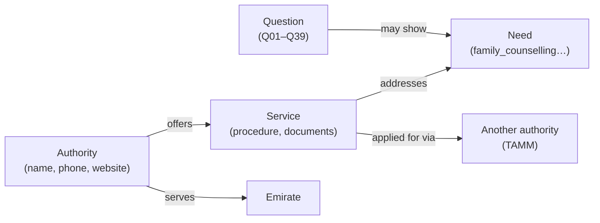

# The support knowledge graph

The "Your next steps" flow in a family's report and the organisations on the All services page both come from one file:
`backend/FamilyResilience.Infrastructure/Content/support-knowledge-graph.v1.json` (D-115). It links what a family answered to
the help that exists, so a report can point somewhere real without any model inventing it.



## How a report uses it

1. **The server walks the graph.** For each answer, room to improve (0 at the top of the scale, 1 at the bottom) flows along
   the question's edges to its needs, then to the services addressing them. An answer at the top of its scale leads nowhere.
   This is ordinary code with no model in it, so the same answers always reach the same services. The weights only order
   services: they aren't scores, and they're never shown or stored.
2. **The model chooses among what was reached.** The part's call gets up to 8 options as `supportOptions` (a whole report's gets
   5 for each area): the code, need, service name, who offers it, whether it's private, where and a summary. It's told to
   prefer public options. It returns `supportCodes` for each improvement, and never sees a procedure, phone number or website.
3. **The server checks the choice and adds the words.** A code that wasn't offered is dropped. If no valid code is left, the
   graph's own order decides among public services. A family's emirate isn't known, so at most 2 services are shown for each
   area of coverage, and a public service is added for any emirate the choice left out. Everything a family reads about an
   organisation comes word for word from this file.

This happens while the person answers, with the rest of the part (D-113), so nothing here adds to the wait at the end.

Some things inference deliberately doesn't do:

- **It never raises protection from harm.** No question asks about it, and guessing from answers about disagreement would be
  wrong and frightening. Those services are on All services, and the report's existing rule points anyone who may be unsafe
  to SOS.
- **It never sends a family to a body with no family-facing service,** such as the Sharjah statistics department and the
  Supreme Council. They're listed on All services with `services: []`.
- **It says nothing about what a family qualifies for.** The organisation decides that. Eligibility in Azwah's own sense is
  untouched: it stays in the deterministic Assignments module.
- **It never sends anything to an organisation.**

## An authority

```json
{
  "code": "example_authority",
  "kind": "government",
  "name": { "en": "Example Authority", "ar": "هيئة مثال" },
  "purpose": { "en": "What it helps families with.", "ar": "بماذا تساعد الأسر." },
  "emirates": ["abu_dhabi"],
  "website": "https://example.gov.ae",
  "phone": "800 000",
  "services": [
    {
      "code": "example_service",
      "name": { "en": "A service", "ar": "خدمة" },
      "summary": { "en": "What it is and who it's for.", "ar": "ما هي ولمن." },
      "needs": ["family_counselling"],
      "procedure": [{ "en": "First, do this.", "ar": "أولًا، افعلوا هذا." }],
      "documents": [{ "en": "An identity card.", "ar": "بطاقة الهوية." }],
      "website": "https://example.gov.ae/service",
      "via": null,
      "evidence": "opened",
      "sources": ["https://example.gov.ae/service"]
    }
  ],
  "sources": ["https://example.gov.ae/about"],
  "approvalReference": "Who approved this, and where it is recorded",
  "checkedOn": "2026-11-06",
  "reviewDue": "2027-05-06"
}
```

| Field | Rule |
| --- | --- |
| `code` | Unique, snake case. A new authority also needs a drawing in `apps/mobile/src/features/services/authorityMarks.ts` (a test checks) and an entry in the app's development fixtures |
| `kind` | `government`, `public_provider` or `private`. A private one carries a note about fees, and shows only if a model picks it or nothing else was reached |
| All text | English and Arabic |
| `emirates` | `uae` or emirate codes |
| `website`, `phone` | `https` only and digits with spaces, or `null`. **`null` is better than a number nobody has confirmed** |
| `services` | May be empty: the organisation is then listed but never reached |
| `needs` | Must exist in the file's `needs` |
| `procedure` | In order. **Empty means no source publishes one**, and the app says so. Never fill it in from general knowledge |
| `via` | The authority it's applied for through, or `null` |
| `evidence` | `opened` (a person or tool read the page itself) or `search_extract` (only a search summary of the page was seen) |
| `sources` | At least one `https` link, for the authority and for each service |
| `approvalReference` | Required: who approved the entry |
| `checkedOn`, `reviewDue` | **Past `reviewDue` the authority disappears from new reports and All services**, so a stale procedure never reaches a family |

A mistake in the file **stops the API from starting**, naming the entry and the problem. `dotnet test` catches it first, and a
test requires every question of the household assessment to have an edge.

The file's `signals` map questions to needs, and only an instrument's approved questions belong there. The mapping is a
judgement about where help might exist, not a scoring rule, so it can change without touching a score.

## What was checked, and what you need to confirm

The owner named the 13 organisations on 2026-11-06. Their facts were researched from public sources that day, and **nobody at
any organisation has reviewed them**. The app says so on every card ("Checked against public sources… confirm with them before
you go"). Before families rely on this, a person should go through this list.

**Decisions only the owner can make**

| Entry | Question |
| --- | --- |
| `acpn` | "ACPN" was taken to mean the American Center for Psychiatry and Neurology, the only UAE family-facing body found using it. Is that who you meant? |
| `sharjah_statistics_community_development` | It's a statistics and policy department with no help service found, so reports never send families there. Did you mean Sharjah Social Services Department? |
| `community_development_authority` | Taken as Dubai's, matching the name exactly. Abu Dhabi's body is a *Department* of Community Development |
| `municipal_presence_centres` | Taken as Abu Dhabi's programme of that name. No addresses or phone were found |
| `tarmeem` | A private surgical hospital, with no prosthetics or orthotics service found. Keep it listed? |

**Checks for a person with a normal browser and a phone**

- **TAMM pages (`evidence: search_extract`):** the tools could not open tamm.abudhabi, so these steps come from search summaries of the official pages. Open each one and compare.
- **Phone numbers:** call `800 444` (Family Care Authority; newest opened page is from 2023). `800 555` is the Abu Dhabi government contact centre, used for Zayed Authority, TAMM and the Family Development Foundation because their own numbers weren't confirmed.
- **Community Development Authority:** its family counselling page didn't load its steps. The one step listed comes from a September 2026 news report.
- **Family Development Foundation:** fdf.gov.ae couldn't be read, so its name and services rest on government media and TAMM.
- **Arabic:** the official names, the Zayed Authority and Sahatna steps and the Community Development Authority's channels come from Arabic sources, lightly adapted to address the family. **All other Arabic text in the file was translated for this file** and needs a reviewer. SEHA's Arabic name comes from its app store listing, and the exact page for Tarmeem's wasn't pinned down.
- **Fees:** one unverified report mentions a consultation fee of about AED 250 at the Zayed Authority, so no fee is stated in the app.

**Gaps in what the 13 cover**

| Gap | What it means |
| --- | --- |
| Budgeting and debt advice | None of the 13 offers it, so budgeting and planning answers (Q23, Q28) lead to no service. `financial_planning` stays in the graph with no service, and a test records that |
| Sharjah and the northern emirates | Nothing public is reached for Sharjah, Ajman, Umm Al Quwain, Ras Al Khaimah or Fujairah. ACPN has a Sharjah branch, and it's private |
| Disability | The questionnaire doesn't ask about it, so only Q39 leads to these services. The services stay on All services for everyone |

**Not in the questionnaire, so not reachable from answers:** housing, employment and protection from harm. Their services are listed on All services only.

## How logos work

Official logos aren't used, at the owner's request. `authorityMarks.ts` holds original drawings in one Azwah style: a pine tile
with a sand and gold line, showing what each organisation does. They hold no text and load nothing. All services says they
aren't the organisations' logos.
