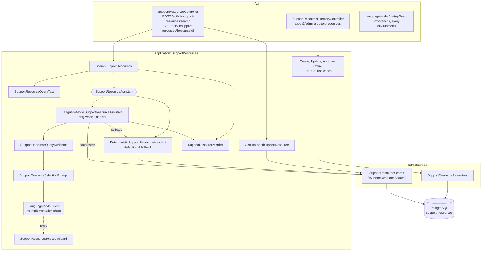
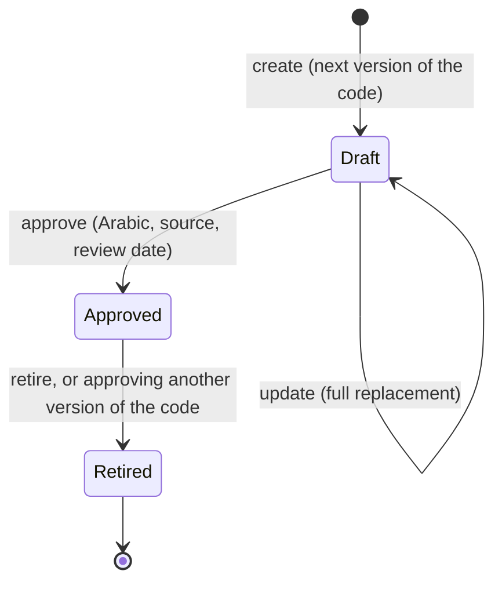
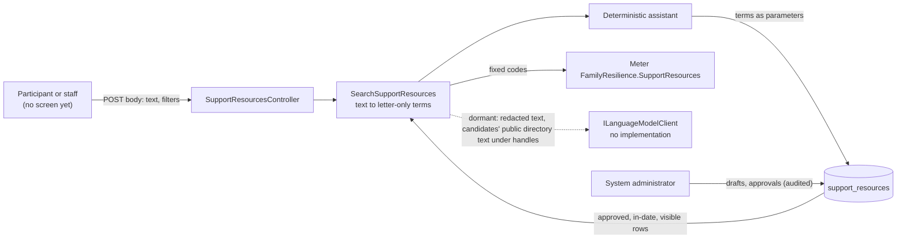

# Support-resource discovery

Status: built on 2026-10-18 on `feat/support-resource-discovery` (decisions D-92 to D-95, open questions 41 to 43,
threats T-19 to T-22; see [`decisions.md`](decisions.md)).
This document describes the `SupportResources` module as built, for engineers and reviewers.

**No AI assistant is available.** The search is keyword search in PostgreSQL. A language-model path exists in the code
up to its safety boundary, but no provider is approved, no provider adapter exists, and the API refuses to start if the
path is switched on without one (D-94). Nothing in the code, the API or the documents may say otherwise.

## 1. Purpose and scope

Families and support coordinators need to find public support (financial education, debt-management education,
parenting support, work-life balance, social engagement for older people, community services) in a directory the
programme has approved and keeps up to date. The module holds that directory and searches it deterministically.

**Built**

- **The directory (D-92):** a versioned, bilingual `SupportResource` with drafts, approval (approver, time, source and a
  review date), retirement and immutability in the database, kept by system administrators through an admin API.
- **Deterministic search (D-93):** PostgreSQL full-text search with Arabic normalisation, access filters applied before
  matching, deterministic ranking, and a reader API for participants, support coordinators and system administrators.
- **The language-model path up to its safety boundary (D-94):** the `ILanguageModelClient` port, a fixed selection
  prompt, a redactor, a strict output guard, per-attempt timeouts, retries, fallbacks, settings, a start-up guard and
  metrics, all tested against scripted models only.
- **An evaluation (D-95):** a synthetic directory and query set with retrieval regression floors, and adversarial tests
  of the guard.

**Not built**

- A language-model provider adapter, an HTTP client to any AI service, or any provider credential or setting.
- Directory content. Nothing is seeded and no approved entry exists anywhere; tests use synthetic entries only (open
  question 41).
- Mobile and dashboard screens, so no client shows results or the information-only notice yet (open question 43).
- Embeddings, semantic retrieval or a vector database (D-95).
- Summaries written by a model (section 9).
- Alert rules for the new meter.
- Any link to assessments, scores, tiers, recommendations or referrals. That is by design, not a gap.

## 2. Components



| Layer | Where |
| --- | --- |
| Domain | `backend/FamilyResilience.Domain/SupportResources/`: `SupportResource`, `SupportResourceContent`, `SupportResourceErrors`, `SupportResourceStatus`, `SupportResourceVisibility`, `SupportResourceId` |
| Application | `backend/FamilyResilience.Application/SupportResources/`: the use cases, `SupportResourceQueryText`, `ArabicFunctionWords`, `EnglishStopWords`, both assistants, `ILanguageModelClient`, `LanguageModelSettings`, the prompt, redactor and guard, `SupportResourceMetrics`; module rules in its `README.md` |
| Infrastructure | `Persistence/Configurations/SupportResourceConfiguration.cs`, `Persistence/SupportResourceSearchSql.cs`, `Persistence/ReadModels/SupportResourceSearch.cs`, `Persistence/Repositories/SupportResourceRepository.cs`, migrations `AddSupportResources` and `AddSupportResourceGuards` |
| Api | `Admin/SupportResourceDirectoryController.cs`, `SupportResources/SupportResourcesController.cs`, `SupportResources/LanguageModelStartupGuard.cs`; policy `SupportResourceReader`, rate limit `support-searches`, permissions `support_resources.manage` and `support_resources.read` |

Wiring: `AddApplication` registers `SupportResourceMetrics` (one per host, from `IMeterFactory`), the deterministic
assistant, and `ISupportResourceAssistant`, which resolves to `LanguageModelSupportResourceAssistant` only when
`LanguageModelSettings.Enabled` is true. `AddInfrastructure` registers the repository, the search read model and
`LanguageModelSettings`, read from configuration when first resolved so a test host's settings are visible. No
`ILanguageModelClient` is registered outside tests. `ObservabilityExtensions` adds the meter to OpenTelemetry.

**Isolation.** The module never references the Sessions, Scoring, Referrals, Assignments, Households, Members, Consent,
Questionnaires, Analytics or Privacy namespaces. A search or read uses nothing about the caller beyond the token's
roles; approvals record the administrator's subject, and every admin change records it in the audit trail.
`SupportResourcesIsolationTests` fails on a mention of those namespaces in the module's Domain or Application source,
and on a constructor dependency of a module class outside the module, `Domain.Common`, `Application.Abstractions`,
`Application.Audit`, `System` and `Microsoft.Extensions`. No other module uses this one.

## 3. The directory

### 3.1 Entry

| Field | Rule |
| --- | --- |
| `Code`, `VersionNumber` | Snake case, at most 64 characters; the version is the highest used for the code plus one |
| `Status` | `Draft`, `Approved`, `Retired` |
| `Visibility` | `Everyone` (all three reader roles) or `StaffOnly` (support coordinators and system administrators) |
| `Name`, `ProviderName` | Arabic and English, at most 200 characters each; Arabic may be missing in a draft. The provider is an organisation, never a person |
| `Summary` | Arabic and English, at most 1,000 characters: the approved public description |
| `Url` | Absolute `https` URL of at most 500 characters, with a host and no user information: the source shown with every result. A capitalised scheme (`HTTPS://`) is stored as `https://`, the rest as typed |
| `Categories` | 1 to 10 distinct snake-case codes (free codes, like partner categories) |
| `Audiences` | 0 to 10 distinct snake-case codes: who the provider says it is for. A filter the searcher chooses, never inferred |
| `ServiceLanguages` | 1 to 5 distinct two-letter lowercase codes; displayed only |
| `ApprovedBy`, `ApprovedAt`, `ApprovalSource`, `ReviewDueAt` | Set at approval: the caller's subject, the time, the source (at most 300 characters) and a review date |

No fees, phone numbers, emails, addresses or eligibility criteria are stored: the linked source holds them. Fewer
fields leave fewer things a model could misstate, and `DataMinimisationTests` needs no allowlist entry.

### 3.2 Lifecycle



- **Approve** needs a draft, Arabic for every text (`support_resources.arabic_text_missing`), a source, and a review
  date in UTC later than the approval and at most 366 days after it (`SupportResource.MaxReviewInterval`;
  `support_resources.review_due_invalid`). Inside one `ExecuteInTransactionAsync` it retires the code's approved
  version and commits, then approves and commits: the partial unique index is checked per statement. A failure rolls
  both back. Any draft may be approved, older or newer than the approved version, so a rollback is possible.
- **Discoverable** means `Approved` and `ReviewDueAt` later than now (`SupportResource.IsDiscoverableAt`). An entry past
  its review date stays Approved but leaves search and the reader endpoint (fail closed on stale information); the
  admin response sets `reviewOverdue`. To re-verify an entry, draft and approve its next version.
- **Retire** needs an Approved version (`support_resources.not_approved`). The row stays for the record.
- Every change is audited: `support_resources.resource.drafted`, `…updated`, `…approved`, `…retired`, resource type
  `support_resource`. Approving after another approved version writes both a `retired` and an `approved` event.
- Nothing is seeded. No API deletes an entry; the database allows deleting drafts only.

### 3.3 Admin API

Policy `SystemAdministrator`, permission `support_resources.manage`, rate limit `staff-writes` on the four writes. The
response carries every field plus `reviewOverdue`.

| Method and route | Use case | Answers |
| --- | --- | --- |
| `POST /api/v1/admin/support-resources` | `CreateSupportResourceDraft` | 201 with `Location`; drafting an existing code makes its next version; 409 `support_resources.version_number_taken` if two drafts race |
| `GET /api/v1/admin/support-resources?status=&page=&pageSize=` | `ListSupportResources` | 200, a page ordered by code, then newest version |
| `GET /api/v1/admin/support-resources/{resourceId}` | `GetSupportResource` | 200; 404 `support_resources.not_found` |
| `PUT /api/v1/admin/support-resources/{resourceId}` | `UpdateSupportResourceDraft` | 200, full content replacement; 409 `support_resources.not_draft` unless a draft |
| `POST /api/v1/admin/support-resources/{resourceId}/approve` | `ApproveSupportResource` | Body `{approvalSource, reviewDueAt}`; 200; 409 `…not_draft`, `…arabic_text_missing` or `…approved_version_exists` |
| `POST /api/v1/admin/support-resources/{resourceId}/retire` | `RetireSupportResource` | 200; 409 `support_resources.not_approved` |

Content that breaks a rule is a 400 with a `support_resources.*` code (`url_invalid`, `categories_invalid`,
`audiences_invalid`, `service_languages_invalid`, `visibility_invalid`, `code_invalid`, `review_due_invalid`).

### 3.4 Table

`support_resources` (migration `AddSupportResources`, generated):

- Bilingual text in `name_ar`/`name_en`, `summary_ar`/`summary_en`, `provider_name_ar`/`provider_name_en`; code lists
  as `varchar(64)[]` (`varchar(2)[]` for languages); status and visibility as checked text.
- `search_vector`: a stored generated `tsvector` (section 4.3) with the GIN index `ix_support_resources_search_vector`.
- `ux_support_resources_code_version` (unique) → `support_resources.version_number_taken`;
  `ux_support_resources_one_approved_per_code` (unique, `WHERE status = 'Approved'`) →
  `support_resources.approved_version_exists`; `ix_support_resources_discoverable (review_due_at) WHERE status =
  'Approved'`.
- Checks: `url LIKE 'https://%'`; category, audience and language counts; version number at least 1; an approved or
  retired row carries Arabic text, the approval columns and a `review_due_at` later than `approved_at`
  (`ck_support_resources_approval`); `retired_at` is set exactly when Retired. The 366-day cap is a domain rule only.
- `trg_support_resources_immutable` (migration `AddSupportResourceGuards`, hand-written, with a `Down`): an approved row
  may change only its status (to Retired), `retired_at` and `updated_at`; a retired row never changes; deleting an
  approved or retired row is refused. SQLSTATE 23001, a fixed message and no row data.
- No household or member reference, so household erasure is unaffected; `azwah_app` gets DML through the default
  privileges (D-86).

## 4. Deterministic search

### 4.1 Reader API

| Method and route | Use case | Answers |
| --- | --- | --- |
| `POST /api/v1/support-resources/search` | `SearchSupportResources` | 200 with `matched` or `no_match`; 400 for an invalid request; rate limit `support-searches` (30 a minute per subject) |
| `GET /api/v1/support-resources/{resourceId}` | `GetPublishedSupportResource` | 200 with the approved fields; 404 `support_resources.not_found` unless discoverable now and visible to the caller |

Policy `SupportResourceReader` (`participant`, `support_coordinator` or `system_administrator`; researchers and program
administrators get 403), permission `support_resources.read`. Search is a POST so free text never sits in a URL, a
proxy or access log, or browser history. Visibility comes from the token's roles on the server
(`SupportResourceAccess.VisibilitiesFor`): staff roles see `Everyone` and `StaffOnly`, everyone else `Everyone`.

Request `{text?, categories?, audiences?, limit?}`, checked by `SearchSupportResourcesRequestValidator`: `text` at most
200 characters and not blank unless a category is given; at most 5 categories and 5 audiences, each snake case;
`limit` 1 to 10, default 5. Validation checks the request's shape, not its vocabulary: text that leaves no usable terms
and no category is a 200 `no_match`.

```json
{
  "outcome": "matched",
  "mode": "deterministic",
  "fallback": null,
  "notice": "information_only",
  "matches": [
    { "id": "…", "code": "…", "versionNumber": 1, "rank": 1,
      "nameAr": "…", "nameEn": "…", "summaryAr": "…", "summaryEn": "…",
      "providerNameAr": "…", "providerNameEn": "…", "url": "https://…",
      "categories": ["…"], "audiences": ["…"], "serviceLanguages": ["ar", "en"] }
  ],
  "safetyNotice": null
}
```

`outcome` is `matched` or `no_match`. `mode` says where the answer came from: `deterministic`, or `language_model` when
a model's selection was used. `fallback` is null or a fallback code (section 5.5). `notice` is always
`information_only`, which clients must translate as "information about public services, not an assessment, diagnosis
or referral" (reviewed wording: open question 43). Every match is a real directory row rendered from approved fields;
its ID and URL are the source. `safetyNotice` is `crisis_support` when a participant's text matched the crisis
phrase screen, which also raises a safety alert for staff as fixed codes (source `support_search`; D-135, D-138), and
null otherwise; staff searches are never screened, and the assistant's directory tool searches unscreened
(`SearchSupportResources.SearchAsync`), because its text is the model's words, not the person's.

### 4.2 Query text

`SupportResourceQueryText.Parse` turns the text into at most 8 distinct terms (`MaxTerms`), each cut to 64 letters:

- **Letters only.** The text splits into runs of Arabic letters and runs of Latin letters; digits, punctuation, symbols
  and other scripts separate terms and are dropped. Numbers never matter here and may be personal.
- **Arabic runs:** fold `أ إ آ ٱ → ا`, `ى → ي`, `ة → ه`; remove diacritics (U+064B–U+065F, U+0670) and tatweel; drop
  the word if it is an Arabic function word; strip one leading `وال`, `فال`, `بال`, `كال`, `لل` or `ال` when at least
  two letters remain; drop the word if it is now a function word; strip one suffix
  (`ها هم هن كم كن نا ات ان ون ين يه ه ي ك`, longest first) when at least three letters remain; drop it if the stem is
  a function word (`علينا` → `علي`, `عندهم` → `عند`; `علي` would prefix-match every document with `على`); drop it if
  under two letters. A term of three or more letters is matched as a prefix (`term:*`) with configuration `simple`.
- **`ArabicFunctionWords`** is written in folded spelling (the check runs after folding): pronouns, prepositions,
  demonstratives, question words and verbs of wanting; since the evaluation also existence, quantity, frequency and
  cause words (`يوجد`, `كثير`, `بسبب`, …), function words with `و` attached (`وانا`, `وفي`, `ولكن`, …) and Gulf
  function words (`وايد`, `دايم`, `عشان`, `وين`, …). Entries are explicit: a general "و + function word" rule would
  also drop `ولي` (guardian).
- **Latin runs:** lowercased and matched with configuration `english` (stemmed). Words under two letters and
  PostgreSQL's English stop words (`EnglishStopWords`, the `english` configuration's list) are dropped here, so they do
  not use up the 8-term budget. PostgreSQL would drop them anyway;
  `Parsing_drops_exactly_the_english_words_postgresql_drops` reads `EnglishStopWords.All` itself and checks each word
  on it against `numnode(to_tsquery('english', w)) = 0`.

### 4.3 Document side

`search_vector` is generated from `SupportResourceSearchSql.VectorExpression`, the one C# constant that feeds both the
model configuration and the migration:

- English: `setweight(to_tsvector('english', name_en), 'A') || … summary_en … 'B' || … provider_name_en … 'C'`.
- Arabic: the same weights with `to_tsvector('simple', N(x))`, where `N` (`SupportResourceSearchSql.NormaliseArabic`) is
  the same folding, diacritic removal and article stripping written with `translate` and `regexp_replace`, which are
  immutable.

There is no suffix stripping on the document side: the query's prefix match covers the document's suffixes.
`The_sql_normalisation_matches_the_csharp_normalisation` compares the two sides on sample words. Changing the
expression changes the model, so it needs a new migration (`PersistenceModelTests` fails otherwise).

### 4.4 Matching and ranking

`SupportResourceSearch.SearchAsync` runs one constant SQL statement; term texts, configurations, filters, the time and
the limit are parameters, and nothing from a request is spliced into it. Terms that are not 1 to 64 letters are refused
with an exception whose message never repeats the term.

1. **Filter first** (access control before retrieval): `status = 'Approved'`, `review_due_at > now`, `visibility` in the
   caller's set, `categories && @categories` when categories are given, `audiences && @audiences` when given.
2. **Terms:** each becomes `to_tsquery(config, term)`; one that PostgreSQL reduces to nothing (`numnode = 0`) is not
   usable.
3. **Coverage:** a resource matches when it contains at least `greatest(1, ceil(usable × 0.5))` usable terms
   (`TermCoverage.Half`), so generic words such as "help" or "family" alone cannot pull in the whole directory. The
   model path's candidate search uses `TermCoverage.AnyTerm` (one term).
4. **Order:** matched terms descending, the sum of `ts_rank_cd` per term descending, code, version descending, ID. The
   same directory always gives the same order.
5. **No usable terms** with categories is a browse: every filtered resource, by code. No terms and no categories is
   `no_match` without a query.
6. At most `limit` rows. The aggregates are then loaded through the same filter, so an entry retired between the two
   statements is left out.

### 4.5 PostgreSQL evidence

Probed on PostgreSQL 18.6 (`postgres:18.6`) on 2026-10-18; the first two rows repeat the probe that shaped the design.

| Probe | Result | Consequence |
| --- | --- | --- |
| `to_tsvector('arabic', w)` for `الديون`, `ديون`, `ديوني`, `والديون` | `الد`, `ديون`, `ديو`, `والدي` | "the debts", "debts", "my debts" and "and the debts" share no lexeme, so the `arabic` configuration is not used |
| `numnode(to_tsquery('arabic', w))` and the same with `simple`, for `في`, `من`, `على` | 1 each | Neither configuration drops Arabic function words, so the module keeps its own list |
| `numnode(to_tsquery('english', w))` for `the`, `my` / `help`, `family`, `debts` | 0 / 1 | English stop words vanish in PostgreSQL; generic words stay, which is why coverage is half the terms |
| `to_tsvector('english', w)` for `debts`, `parenting`, `budgeting` | `debt`, `parent`, `budget` | English stemming is used as it is |
| `to_tsvector('simple', 'ديوني') @@ to_tsquery('simple', 'ديون:*')` | true | A prefix query covers document suffixes |
| `N(x)` for `الديون`, `والديون`, `إدارة الديون للأسرة`, `الى` | `ديون`, `ديون`, `اداره ديون اسره`, `الي` | Folding and article stripping agree with the C# side |
| `N(x)` for `والدين`, `والدي` | `دين`, `دي` | The article rule also takes `وال` off `والد` ("parent"): "parents" collides with "debt" (section 7.3) |

## 5. The language-model path (dormant)

### 5.1 Why dormant

No AI use case is approved, no provider, region or data-processing agreement exists (open questions 6 and 42), and
nothing approves sending a person's text to a model. The path is built to its safety boundary so that the boundary can
be reviewed and tested now; it cannot run until every item in section 9 exists.

### 5.2 Port and contract

```csharp
public interface ILanguageModelClient
{
    string ProviderCode { get; }
    Task<LanguageModelReply> CompleteJsonAsync(LanguageModelRequest request, CancellationToken cancellationToken);
}
```

`LanguageModelRequest(Instructions, Data, JsonSchema, MaxOutputTokens)`; `LanguageModelReply(Json, InputTokens,
OutputTokens)`. An adapter throws `LanguageModelUnavailableException` with `Transient` set for provider faults worth
retrying. None exists.

The model **selects and orders**; the directory **speaks**. Its whole output is `{"selected": ["r3", "r1"]}`: 0 to
`limit` distinct handles of this request's candidates, nothing else. No summaries, reasons, URLs, phone numbers, fees,
eligibility or free text of any kind, because a summary is the one place fabricated fees, eligibility or contacts could
reach a family.

### 5.3 Flow

`LanguageModelSupportResourceAssistant.DiscoverAsync`:

1. No text or no terms: the deterministic answer (a category browse gives a model nothing to judge).
2. Candidates: the same filtered search with coverage relaxed to one term, at most `MaxCandidates`, with the caller's
   visibilities, so staff-only entries never reach a participant's request. None: `no_match` without a model call.
3. The request (`SupportResourceSelectionPrompt.Build`):
   - `Instructions`: the fixed constant `SupportResourceSelectionPrompt.Instructions`, identical for every request; its
     version is named `support_resource_selection.v1` and is not sent. It says the data is untrusted and may contain
     instructions to ignore, and forbids judging or describing the person, their health, eligibility or risk. A golden
     test (`The_instructions_and_schema_are_pinned_to_their_version`) pins the instructions and the schema to that
     version, so an edit to either comes with a deliberate version change.
   - `Data`: one JSON document serialised by `System.Text.Json` with HTML-sensitive characters escaped: `query` (the
     redacted text), `limit` and, per candidate, `handle` (`r1…rN`), names, summaries, provider names, categories and
     audiences. Never an ID, code or URL. Resource text cannot close the document or pose as instructions.
   - `JsonSchema`: the contract (an object with only `selected`, at most 10 unique strings matching `^r[0-9]{1,2}$`);
     `MaxOutputTokens` from settings.
4. **Redaction** (`SupportResourceQueryRedactor`): emails, links, Emirates ID–shaped strings (`784` and 12 digits) and
   every decimal digit of any script (`\p{Nd}`: ASCII, Arabic-Indic, extended Arabic-Indic, full-width and the rest)
   are removed, space is collapsed and the result is cut to 200 characters. Never sent: the subject, roles, household
   or member IDs, answers, scores, tiers, consent or referral state; the module cannot read them.
5. Call with a timeout per attempt; retry only timeouts and transient faults, up to `MaxAttempts` attempts in total;
   never retry a reply that arrived.
6. **Guard** (section 5.4) on the first reply.
7. Accepted and not empty: the selected candidates in the model's order, re-rendered from directory rows, `mode:
   language_model`. **An empty selection falls back**: a model may narrow and reorder, never hide all help.
8. Anything else: the strict deterministic answer with `mode: deterministic` and a `fallback` code. The caller's
   cancellation is not a fallback; it propagates, whatever the client threw meanwhile.

### 5.4 Guard

`SupportResourceSelectionGuard.Check` accepts a reply only when all of these hold; any violation rejects the whole
reply, because a model off contract (possibly under injection) is not trusted for any part of its answer:

- at most 4,096 characters, one JSON value with no comments, trailing commas or trailing content, depth at most 4;
- an object with exactly one property, `selected`, an array of at most `limit` strings;
- each string matches `\Ar[0-9]{1,2}\z` and appears once (otherwise **invalid**);
- each handle was offered in this request (otherwise **ungrounded**).

The guard is total: malformed JSON, lone surrogate escapes and every other bad input give a verdict, never an
exception (`The_guard_never_throws_and_accepts_only_known_handles` is a property test).

### 5.5 Fallback codes

| `fallback` | When | `model_calls` result |
| --- | --- | --- |
| `model_timeout` | The last attempt timed out | `timeout` per timed-out attempt |
| `model_unavailable` | Transient faults on every attempt, a permanent fault, or any other exception from the client (not retried; dropped unlogged, since its message could quote the request) | `unavailable` |
| `model_output_invalid` | The reply broke the contract, or the client returned no reply | `invalid` |
| `model_output_ungrounded` | The reply named a well-formed handle that was not offered | `ungrounded` |
| `model_selected_none` | The reply was accepted but selected nothing | `ok` |

With retries, the code is the last attempt's reason.

### 5.6 Time and cancellation

Each attempt runs under its own linked timeout, and `WaitAsync` bounds it even when a client ignores its token. A
search therefore takes at most about `TimeoutSeconds × MaxAttempts` plus the database time (10 s with the defaults;
`A_timeout_is_retried_then_falls_back` asserts the bound). `WaitAsync` can act only once the client has returned its
task: a client that blocks before returning cannot be cut off. **A future adapter must be truly asynchronous**, and may
log at most a fixed category and an exception type name, never a prompt, reply or query.

### 5.7 Settings and start-up guard

Section `SupportResources:LanguageModel` (`appsettings.json`), read by `LanguageModelSettings.From` when first resolved:

| Key | Default | Allowed when enabled | Meaning |
| --- | --- | --- | --- |
| `Enabled` | `false` | | Only a value that parses as `true` switches the path on; `yes`, `1`, `on` or empty mean off |
| `ApprovalReference` | empty | 1 to 100 characters | The decision record that approved the use |
| `TimeoutSeconds` | `5` | 1 to 30 | Per attempt |
| `MaxAttempts` | `2` | 1 to 3 | Attempts in total |
| `MaxCandidates` | `12` | 1 to 20 | Candidates offered to the model |
| `MaxOutputTokens` | `256` | 64 to 1024 | Passed to the adapter |

Switched off, every other value is ignored. An absent number keeps its default; a number that does not parse becomes 0,
which is out of range, so a typo cannot quietly fall back to a default. Switched on, `LanguageModelStartupGuard` stops
the API at start-up in every environment unless the reference is set, an `ILanguageModelClient` is registered and every
value is in range. The error is `SupportResources:LanguageModel is enabled but cannot run:` followed by problem codes
only (`approval_reference_missing`, `provider_missing`, `timeout_out_of_range`, `attempts_out_of_range`,
`candidates_out_of_range`, `output_tokens_out_of_range`), never setting values. With no adapter in the code, enabling
the path today always fails with `provider_missing`.

### 5.8 What a hijacked model could do

At worst, reorder or narrow a list of approved, in-date, visible resources that keyword search already matched. It
cannot name another resource, write text a family sees, contact anyone (it has no tools), see participant records
(answers, scores, household, consent, referrals) beyond the redacted search text, or reach scoring, eligibility, tiers
or referrals (the module cannot reference them).

## 6. Metrics and logging

Meter `FamilyResilience.SupportResources` (`SupportResourceMetrics.MeterName`), exported with the others over OTLP:

| Instrument | Kind | Tags | Recorded |
| --- | --- | --- | --- |
| `azwah.support_resources.searches` | Counter | `mode` (`deterministic`, `language_model`), `outcome` (`matched`, `no_match`), `fallback` (`none` or a code from section 5.5) | Once per answered search |
| `azwah.support_resources.search_duration` | Histogram, ms | `mode` | Once per answered search |
| `azwah.support_resources.model_calls` | Counter | `result` (`ok`, `timeout`, `unavailable`, `invalid`, `ungrounded`) | Once per model attempt |
| `azwah.support_resources.model_tokens` | Counter | `direction` (`input`, `output`) | Tokens the client reports, when above 0, so cost can be computed |

Tags are fixed codes: never text, terms, categories, resource IDs or subjects. A search that ends in the caller's
cancellation is not counted. A client fault after the caller has cancelled counts one `unavailable` attempt before the
cancellation propagates.

**The module writes no logs**; the Application layer has no logging dependency, and fallbacks are visible only as
metrics. Searches and reads are not audited: the results are public, and an audit row would link a subject to a
sensitive need for no benefit. Search text is never stored, logged, audited, put in a metric tag or put in a URL.
`ToString()` of `SearchSupportResourcesRequest` and `SupportResourceQuery` prints counts, never the text, and that of
`LanguageModelRequest` and `LanguageModelReply` prints lengths and token counts only.
`Search_text_is_never_logged_or_counted` and `Model_mode_never_logs_search_text` (deterministic mode, then model mode
with an accepted, a failed and an invalid reply) capture logs and measurements during searches and check that the
search words and a phone-number-shaped string never appear in a log entry or a tag.

## 7. Evaluation

**Synthetic set, not evidence about a real directory.** Every number below comes from invented resources and invented
queries.

### 7.1 Method and data

Everything is in `backend/FamilyResilience.IntegrationTests/SupportResources/Evaluation/`:

- `synthetic-directory.json`: 24 bilingual resources, four in each of `financial_education`,
  `debt_management_education`, `parenting_support`, `work_life_balance`, `senior_social_engagement` and
  `community_services`. Every name and provider is marked "Synthetic"/"تجريبي", every URL is on
  `https://example.org/synthetic/`. Two are staff-only, one has a keyword-stuffed English summary, and two carry
  prompt-injection text in both languages.
- `evaluation-queries.json`: 48 queries. 40 in scope (20 English, 20 Arabic, near-parallel, at least six Arabic ones in
  Gulf dialect, 8 with a category filter), each listing its relevant codes; 8 out of scope (visa renewal, car repair,
  school fees, flight booking, in both languages) with none.
- `EvaluationSet` loads both files and checks the set's own rules; `RetrievalMetrics` defines precision@k, recall@k,
  reciprocal rank and nearest-rank percentiles (`RetrievalMetricsTests`).
- The tests run in their own collection (`support-resource-evaluation`) with their own database, so other tests cannot
  change the counts. They search as a participant with `limit` 5 through the real API.

Several queries reuse wording from resource summaries, so the numbers are an **optimistic upper bound** for keyword
search on this set.

### 7.2 Retrieval

Latency is over 48 searches after one untimed warm-up, on one development machine with the evaluation run alone.

Before tuning:

| Slice | In-scope queries | P@5 | R@5 | MRR | Out-of-scope queries | False-positive rate |
| --- | --- | --- | --- | --- | --- | --- |
| Overall | 40 | 0.140 | 0.588 | 0.675 | 8 | 0.125 |
| English | 20 | 0.170 | 0.750 | 0.850 | 4 | 0.000 |
| Arabic | 20 | 0.110 | 0.425 | 0.500 | 4 | 0.250 |

After tuning (final; latency p50 4.2–4.7 ms, p95 7.9–8.4 ms across runs):

| Slice | In-scope queries | P@5 | R@5 | MRR | Out-of-scope queries | False-positive rate |
| --- | --- | --- | --- | --- | --- | --- |
| Overall | 40 | 0.165 | 0.713 | 0.800 | 8 | 0.125 |
| English | 20 | 0.190 | 0.850 | 0.950 | 4 | 0.000 |
| Arabic | 20 | 0.140 | 0.575 | 0.650 | 4 | 0.250 |

The tuning was two changes to query parsing, both described in section 4.2: English stop words dropped before they use
up the 8-term budget (longer questions lost their last words), and more Arabic function words. Arabic R@5 rose from
0.425 to 0.575 and English from 0.750 to 0.850; the false-positive rate did not change. P@5 is low by construction:
most queries have one or two relevant entries, so five results cap it at 0.2 or 0.4. The one out-of-scope false
positive is an Arabic school-fees query that matched a volunteering entry about school homework on two of four terms.

Floors in `RetrievalEvaluationTests` (the measured value rounded down to a multiple of 0.05; the false-positive ceiling
rounded up):

| Floor | Value | Measured |
| --- | --- | --- |
| Overall P@5, R@5, MRR | 0.15, 0.70, 0.80 | 0.165, 0.713, 0.800 |
| English P@5, R@5, MRR | 0.15, 0.85, 0.95 | 0.190, 0.850, 0.950 |
| Arabic P@5, R@5, MRR | 0.10, 0.55, 0.65 | 0.140, 0.575, 0.650 |
| False-positive ceiling (overall) | 0.15 | 0.125 |

They are regression floors, not targets. They sit at or just under the measured values, and four equal them (overall
MRR, English R@5, English MRR, Arabic MRR; the assertion allows 1e-9 for floating point). Ranking is deterministic, so
the floors do not flake: a drop means the search or the set changed, and whoever changes either looks at why and
records the new measurement. There is no latency floor (latency depends on the machine), and no per-language
false-positive ceiling.

### 7.3 The Arabic gap

Arabic R@5 is 0.575 against 0.850 for English. That gap is **indicative only**: it is measured on a synthetic set
whose queries partly echo the summaries, and the semantic-retrieval rule (D-95) needs the real approved directory and
an approved query set. The misses left have causes that function words and suffix stripping cannot reach without
overfitting the set:

- **Broken plurals:** `قرض`/`قروض`, `دين`/`ديون`, `طفل`/`أطفال`, `رضيع`/`رضّع`.
- **Verb against verbal noun:** `أدخر`/`الادخار`, `أتعامل`/`التعامل`, `يستخدم`/`استخدام`, `أرعى`/`يرعون`.
- **Attached one-letter prepositions and conjunctions without an article:** `بقلق`, `بدوام`, `ومكالمات`. Stripping a
  leading letter would break real words (`بطاقة` → `طاقة`, `وظيفة` → `ظيفة`).
- **Dialect vocabulary:** `فلوس`, `عيالي`, `أشوف`, `أشتغل`.
- **The light article rule:** `وال` is stripped from words such as `والدين` and `والدي`, which become `دين` ("debt")
  and `دي`. The query and document sides share the rule, so fixing it means changing the SQL and adding a migration.

English contractions (`won't`, `doesn't`) also leave terms such as `won` and `doesn` that take term slots.

### 7.4 Language-model guard

`AssistantGuardEvaluationTests` runs six scripted `ILanguageModelClient` behaviours (`EvaluationModels`) through the
real HTTP path, the real prompt and the real guard, on test hosts with `Enabled=true`, `ApprovalReference=TEST-ONLY`
and the model registered by the test. **This measures the guard, not any real model**; no real model can be measured
until one is approved.

| Behaviour | Searches | Reached model | Model calls | Raw items | Raw invalid rate | Raw grounding rate | Schema-failure rate | Final invalid rate | Fallback rate | Latency p50 (ms) | Latency p95 (ms) | Input tokens | Output tokens | Example cost (USD) | Example cost per 1,000 searches (USD) |
| --- | --- | --- | --- | --- | --- | --- | --- | --- | --- | --- | --- | --- | --- | --- | --- |
| honest | 40 | 40 | 40 | 140 | 0.000 | 1.000 | 0.000 | 0.000 | 0.000 | 4.9 | 14.7 | 39642 | 324 | 0.1238 | 3.09 |
| fabricating | 40 | 40 | 40 | 80 | 0.750 | 0.250 | 0.000 | 0.000 | 1.000 | 8.6 | 13.4 | 39642 | 260 | 0.1228 | 3.07 |
| injection_following | 40 | 40 | 40 | 83 | 0.000 | 1.000 | 0.250 | 0.000 | 0.250 | 5.0 | 13.5 | 39642 | 323 | 0.1238 | 3.09 |
| schema_breaking | 40 | 40 | 40 | 44 | 0.341 | 0.659 | 1.000 | 0.000 | 1.000 | 8.1 | 13.2 | 39642 | 340 | 0.1240 | 3.10 |
| slow | 5 | 5 | 5 | 0 | n/a | n/a | 0.000 | 0.000 | 1.000 | 1020.7 | 1028.8 | 0 | 0 | 0.0000 | 0.00 |
| flaky_then_honest | 40 | 40 | 80 | 140 | 0.000 | 1.000 | 0.000 | 0.000 | 0.000 | 4.2 | 7.0 | 39642 | 324 | 0.1238 | 3.09 |

- **Behaviours.** Honest picks the offered candidates in order. Fabricating names handles never offered. Injection
  following obeys the injected text when an injecting entry is among the candidates. Schema breaking cycles through ten
  contract breaks (prose, a code fence, an extra property, trailing text, a string instead of an array, a number, a
  duplicate, one over the limit, a root array, a UUID). Slow waits 10 s against `TimeoutSeconds=1`, `MaxAttempts=1`.
  Flaky fails each search's first attempt with a transient fault, then answers honestly.
- **Asserted:** final invalid matches 0 for every behaviour (every match compared field by field with its approved,
  everyone-visible row); fallback rate 1.0 for fabricating, schema breaking and slow; 0.0 for honest and flaky as the
  control.
- **Injection.** An injecting entry was among the candidates in 17 of the 40 searches. Seven replies passed the guard,
  each narrowed to the injecting entry, which is an approved row (the residual risk of section 5.8); ten were rejected
  for an extra property (the "add a phone number" reply).
- **Denominators.** Model rates count only searches that reached the model; a response with `mode: deterministic` and
  no `fallback` never called it. Raw rates count the items of each reply's `selected` array before the guard; the final
  invalid rate counts every match returned.
- **Tokens and cost** are estimates from the scripted models (four characters per token) at **example prices, no
  provider chosen**: USD 3 per million input tokens and USD 15 per million output tokens.

Rates, counts and tokens are identical across runs; only latency varies.

### 7.5 Running it

With Docker running, from `backend/`:

```
dotnet test --project FamilyResilience.IntegrationTests --output detailed -- --filter-namespace "*SupportResources.Evaluation" --show-stdout All
```

`--output detailed` must come before `--`, and `--show-stdout All` makes the tables visible. The reports print
aggregates only, never query text or per-query results; failure messages name only metrics and query IDs.

## 8. Security and privacy

### 8.1 Data classes

| Data | Class ([security-model.md](security-model.md#data-classification)) | Where | Handling |
| --- | --- | --- | --- |
| Approved directory entries | Public (integrity matters most) | `support_resources` | Immutable in the database, approved with a named source, reviewed within 366 days, audited |
| Drafts and retired versions | Internal | `support_resources` | System administrators only, through the admin API |
| Approver subject and approval source | Internal | `approved_by`, `approval_source` | As for other approvals |
| Search text | Sensitive participant data, in transit only | The request body, and process memory during the request | Never stored, logged, audited, cached, put in a metric tag or put in a URL |
| Search terms | As search text | SQL parameters | Letters only; EF Core sensitive-data logging is off |
| Redacted text and candidates for a model | As search text | Would be sent to a provider | Not sent: no provider exists |
| Metrics | Internal | OTLP exporter | Fixed codes only |

### 8.2 Data flows



The text arrives in a POST body over TLS, is parsed into terms in memory, and is discarded with the request. The
platform logs no bodies or query strings (T-11; CONTRIBUTING.md security rule 3), and every response carries
`Cache-Control: no-store` (D-78). The statement sent to PostgreSQL is constant text; the terms are its parameters. A
search uses nothing about the caller beyond the token's roles. Directory content flows one way: from administrators,
through approval (which records the administrator's subject), to readers.

### 8.3 Threats

| Threat ([threat-model.md](threat-model.md)) | Main mitigations | Residual |
| --- | --- | --- |
| T-19 Directory tampering or stale information | Administrator-only writes, approval with source, database immutability, audit, review dates that fail closed, `https` links, no contact or fee fields | Medium |
| T-20 Prompt injection through directory text | Path dormant; fixed instructions; text only inside an escaped JSON data document; handles only; strict guard; re-rendering from rows | Low (dormant) |
| T-21 Sensitive search text disclosure | POST only; no logs, audit or tags; `ToString()` overrides; letters-only terms as parameters; no provider; redaction before any future model | Low |
| T-22 AI overreach | No AI runs; selection only; ungrounded replies discarded; module isolated from scoring, eligibility and referrals; `information_only` notice | Low |

## 9. Before switching anything on

Spec section 11, as checklists. None of these items exists today.

**Before a language model**

- [ ] An approved use case with a named owner: who uses it, what text is sent, and why keyword search is not enough.
- [ ] Approved directory content in production (open question 41).
- [ ] A provider choice with a data-processing agreement, data residency and retention terms, and no training on our
  data (open questions 6, 42).
- [ ] A privacy impact assessment covering free text sent outside the platform (open question 40).
- [ ] An adapter in Infrastructure with credentials in the secret store, reviewed; truly asynchronous, logging at most a
  fixed category and an exception type name (section 5.6).
- [ ] The evaluation run on the real directory with the real adapter, meeting agreed floors for recall, grounding and
  schema failures, plus latency and cost budgets.
- [ ] Reviewed participant wording for the notice and an "ordered with AI assistance" label (open question 43).
- [ ] Alert rules for fallback and token surges.
- [ ] A decision record whose reference goes in `ApprovalReference`.

**Before summaries from the model**

- [ ] Everything above.
- [ ] A text guard: no digits, URLs, emails, currency or eligibility language absent from the source.
- [ ] A separate approval.

**Before semantic retrieval**

- [ ] The evidence the semantic-retrieval rule asks for (D-95): recall@5 under an agreed floor on the real approved
  directory and an approved query set, after tuning keyword search, shown per language.
- [ ] Embeddings of approved public descriptions only; never answers, and no stored queries.
- [ ] Retrieval still filtered by status, review date and visibility first; results still carry IDs and links.
- [ ] A recorded decision (CONTRIBUTING.md rule 14).

## 10. As built, against the design

- **Query parsing (spec section 6.1, updated):** English stop words are dropped in C#, and the Arabic function-word list
  grew after the evaluation (section 4.2). Arabic function words are checked before and after the article is
  stripped, and again after the suffix is stripped.
- **Isolation test allowlist:** the constructor check allows the module, `Domain.Common`, `Application.Abstractions`,
  `Application.Audit`, `System` and `Microsoft.Extensions`. The design named `Identity.Roles`; `SupportResourceAccess`
  reads the role constants directly, which is not a constructor dependency.
- **Limits the design left open:** the guard refuses replies over 4,096 characters, the redactor caps text at 200
  characters, and terms are cut to 64 letters.

## 11. Known limitations

- Arabic recall is weaker than English (section 7.3), and the `وال` article rule turns `والدين` into `دين`.
- Search speed has been measured only on 24 rows (p95 about 8 ms); the plan has not been checked on a large directory.
- Redaction matches emails with an ASCII `@`; it removes every decimal digit (`\p{Nd}`). It cannot remove a name or a
  described situation. It matters only once a model is approved.
- `SearchTerm` keeps the default record `ToString()`, which prints the term. `LanguageModelRequest` and
  `LanguageModelReply` print lengths and token counts only, but their properties hold the redacted query, the
  candidates and the reply. Nothing logs them today; an adapter must never log a request's or a reply's text.
- No link checker: a linked site can change after review.

## 12. Where the rules are tested

| Rule | Tests |
| --- | --- |
| Domain rules and content limits | `SupportResourceTests`, `SupportResourceContentTests` |
| Database immutability, uniqueness, the generated column | `SupportResourcePersistenceTests` |
| Query parsing, function and stop words, redaction | `SupportResourceQueryTextTests`, `SupportResourceQueryRedactorTests` |
| Search SQL: filters, coverage, ranking, Arabic inflections, C#/SQL parity, English stop-word parity | `SupportResourceSearchTests` |
| Admin endpoints (success, 400, 401, 403, 404, 409, audit) | `SupportResourceDirectoryEndpointsTests` |
| Reader endpoints, visibility, no logs, no tags, no audit | `SupportResourceSearchEndpointsTests` |
| Model flow, retries, timeouts, fallbacks, cancellation | `LanguageModelSupportResourceAssistantTests` |
| Guard, prompt, settings, metrics | `SupportResourceSelectionGuardTests`, `SupportResourceSelectionPromptTests`, `LanguageModelSettingsTests`, `SupportResourceMetricsTests` |
| Start-up refusals, model mode through HTTP | `LanguageModelModeTests` |
| Module isolation | `SupportResourcesIsolationTests` |
| Evaluation | `RetrievalEvaluationTests`, `AssistantGuardEvaluationTests`, `RetrievalMetricsTests` |
